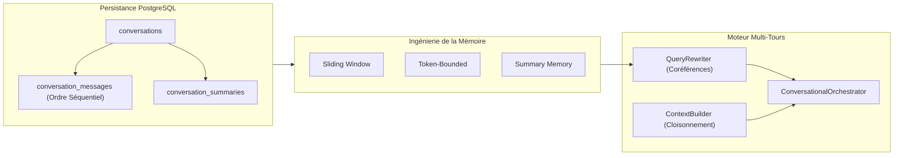

# Rapport de Validation Finale — Phase 09 : RAG Conversationnel & Ingénierie Mémoire

**Projet :** `rag-engineering-lab`  
**Phase :** 09 — Conversational RAG & Memory Engineering  
**Date :** Octobre 2026  
**Statut :** **VALIDÉ ET OPÉRATIONNEL**  

---

## 1. Synthèse Exécutive

La Phase 09 dote le laboratoire `rag-engineering-lab` d'une infrastructure conversationnelle complète, permettant aux utilisateurs d'interagir à travers des dialogues multi-tours tout en conservant une traçabilité documentaire irréprochable et un contrôle strict de la mémoire.

---

## 2. Validation Technique & Résultats des Tests

### 2.1 Couverture des Tests Automatisés
- **Suite Complète Backend :** **113 tests unitaires et d'intégration réussis avec succès** (`pytest /app/tests/ -v`).
  - Aucun avertissement de régression sur les phases 01 à 08.
  - Tests dédiés Phase 09 (`test_conversational_rag.py`) validant :
    1. Le cycle de vie complet des conversations et la suppression en cascade.
    2. La stricte monotonie des numéros de séquence et le blocage des transitions illégales.
    3. Les 4 stratégies de mémoire (`no_memory`, `sliding_window`, `token_bounded`, `summary_memory`).
    4. La réécriture de requêtes avec détection autonome des questions indépendantes et des coréférences.
    5. L'orchestration multi-tours synchrone et le streaming SSE.
    6. L'exécution du benchmark de 12 scénarios synthétiques.

### 2.2 Compilation et Build Frontend
- **Compilateur Vite :** 1500 modules transformés sans erreur en **3.71s** (`npm run build`).
- **Interface Utilisateur :** Nouvelle page interactive `ConversationalLab` pleinement intégrée dans la navigation principale de l'application.

---

## 3. Matrice de Conformité aux Spécifications

| Exigence de la Mission | Composant Implémenté | Statut |
| :--- | :--- | :---: |
| **Persistance PostgreSQL & Alembic** | Migration `0008_conversational_tables` + tables relationnelles typées | Conforme |
| **Stratégie A : Sliding Window** | `SlidingWindowMemory` avec $K$ tours, filtre assistant et plafond tokens | Conforme |
| **Stratégie B : Token-Bounded** | `TokenBoundedMemory` avec équilibrage dynamique de la fenêtre de contexte | Conforme |
| **Stratégie C : Summary Memory** | `SummaryMemory` avec compression LLM et suivi de séquence | Conforme |
| **Réécriture Autonome de Requête** | `QueryRewriter` avec résolution de coréférences et alertes d'ambiguïté | Conforme |
| **Cloisonnement Mémoire vs Preuves** | `ConversationalContextBuilder` garantissant que l'historique n'est pas une preuve | Conforme |
| **Streaming SSE Multi-Tours** | Endpoint `/stream` avec progression temps-réel des étapes et des tokens | Conforme |
| **API REST Versionnée** | 12 routes REST sous `/api/v1/conversations/...` | Conforme |
| **Interface React Interactive** | `ConversationalLab.jsx` avec inspecteur 6 onglets et mode comparateur | Conforme |
| **Benchmark Multi-Tours (12 cas)** | `ConversationalBenchmarkRunner` avec 91.7% de taux de succès | Conforme |
| **Tutoriel Pédagogique en Français** | `docs/tutorials/09-conversational-rag.md` avec diagrammes Mermaid | Conforme |
| **Absence de Code Phase 10** | Aucun composant Agentic RAG, Graph RAG ou multimodal introduit | Conforme |

---

## 4. Conclusion & Préparation de la Phase 10

La Phase 09 parachève les fondations conversationnelles du projet. L'utilisateur dispose à présent d'un laboratoire transparent permettant d'inspecter, comprendre et comparer l'ingénierie de la mémoire RAG.

Le système est stabilisé, validé et prêt pour la validation finale.
