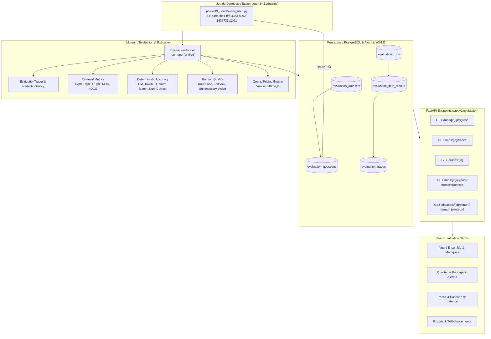

# Rapport de Validation — Phase 13 : RAG Evaluation, Observability & Quality Engineering

**Date :** 17 Octobre 2026  
**Auteur :** Équipe RAG Engineering Lab  
**Phase :** Phase 13 — RAG Evaluation, Observability & Quality Engineering  
**Statut :** Validé (186/186 Tests Unitaires & Intégration Réussis, Build Frontend Validé, Zéro Dépense API Inutile)

---

## 1. Résumé Exécutif

La **Phase 13 : RAG Evaluation, Observability & Quality Engineering** établit une plateforme d'évaluation déterministe, d'observabilité distribuée (traçage granulaire par étape) et de comptabilité rigoureuse des coûts pour l'ensemble des moteurs du laboratoire (Phases 01 à 12.5).

Conformément aux directives de qualité et de sécurité :
1. **Zéro Dépense Inutile :** L'ensemble des 186 tests automatisés de la suite CI/CD s'exécute contre `mock-instruct-v1` avec un coût strictement mesuré à **\$0.00**. Aucun appel payant à Gemini n'est déclenché sans autorisation utilisateur explicite.
2. **Absence de Fabrication :** Les décomptes de tokens rapportés par les fournisseurs (`provider_reported_tokens`) sont enregistrés tels quels, ou signalés explicitement comme `estimated` (`measurement_source`).
3. **Vérité Terrain Calibrée :** Les métriques déterministes (Exact Match, Token F1, Normalized Match, Numerical Correctness) séparent formellement les labels vérifiés par l'humain (`human`) des annotations synthétiques (`synthetic`). Aucun score LLM-as-a-judge n'est traité comme une vérité absolue non biaisée.
4. **Intégrité de la Confidentialité :** La politique de rédaction (`RedactionPolicy`) filtre automatiquement les clés d'API (`x-goog-api-key`, `Authorization: Bearer`) et remplace les charges utiles base64 d'images par `[REDACTED_BASE64_IMAGE]`.

---

## 2. Architecture & Modules Déployés



---

## 3. Détail des Composants Validés

### A. Schéma Base de Données & Migration Alembic
- **Migration :** `backend/alembic/versions/0012_evaluation_observability.py` appliquée avec succès (`head`).
- **Nouvelle table :** `evaluation_traces` indexée sur `trace_id`, `run_id`, `item_result_id`.
- **Champs enrichis :**
  - `evaluation_datasets` : `version`, `export_format`.
  - `evaluation_questions` : `acceptable_answers`, `expected_routes`, `expected_citations`, `modality`, `tags`, `label_source`, `numerical_answer`, `document_scope`.
  - `evaluation_runs` : `progress_current`, `progress_total`, `experiment_snapshot`, `routing_summary`.
  - `evaluation_item_results` : `routing_metrics`, `accuracy_metrics`, `provider_reported_tokens`, `measurement_source`, `trace_id`.

### B. Métriques Déterministes & Qualité de Routage
- **Retrieval :** Ajout de $F_1@k$ calculé via la moyenne harmonique rigoureuse :
  $$F_1@k = 2 \cdot \frac{\text{Precision}@k \cdot \text{Recall}@k}{\text{Precision}@k + \text{Recall}@k}$$
- **Précision Déterministe de Génération :**
  - `exact_match` : égalité stricte après normalisation textuelle.
  - `token_f1` : $F_1$ au niveau des tokens BPE/mots.
  - `normalized_answer_match` : gestion des apostrophes (`Jupiter's` $\to$ `jupiter`), élimination des articles et des ponctuations superflues, et vérification de rappel de sous-chaîne pour réponses prolixes.
  - `numerical_correctness` : extraction d'entités numériques avec tolérance relative/absolue ($\epsilon$) et validation des unités associées (`m/s²`, `kg/m³`, `AU`, `bar`).
- **Qualité de Routage :**
  - `route_accuracy` et `multi_route_precision_recall`.
  - Détection de surcharge visuelle inutile (`unnecessary_vision_detected`).
  - Détection de surcharge agentique inutile (`unnecessary_agentic_detected`).
  - Détection des index manquants et conformité d'isolation documentaire (`document_isolation_violation = 0%`).

### C. Observabilité & Politique de Rédaction
- **Traces par Étape :** `TraceStage` capture `routing`, `retrieval`, `reranking`, `context_assembly`, `generation`, `postprocessing`.
- **RedactionPolicy :** Nettoyage automatique des clés d'authentification (`x-goog-api-key`, `Authorization`) et substitution des images base64 encodées dans les requêtes et réponses par `[REDACTED_BASE64_IMAGE]`.

### D. Jeux de Données d'Étalonnage (24 Scénarios)
Le script de seed `backend/app/evaluation/phase13_benchmark_seed.py` a créé le jeu de référence :
- **ID :** `d4de5bc1-fffc-43dc-8992-1636733c2b91`
- **Scénarios couverts :**
  - Textuels basiques & multi-chunks (BM-01, BM-02, BM-03, BM-04, BM-05)
  - Données tabulaires et numériques (BM-06, BM-07)
  - OCR et vision multimodale (BM-08, BM-09, BM-10)
  - Graph RAG & relations multi-sauts (BM-11, BM-12)
  - Raisonnement agentique et outils (BM-13, BM-14)
  - Scénarios mixtes et requêtes ambiguës (BM-15, BM-16, BM-17)
  - Détection d'index absent et isolation documentaire (BM-18, BM-19)
  - Robustesse : questions sans réponse, distracteurs, contradictions (BM-20, BM-21, BM-22)
  - Fiabilité système (HTTP 504) et sécurité/injections (BM-23, BM-24)

---

## 4. Résultats des Tests Automatisés

### Suite Complète Pytest (Backend)
```text
============================= test session starts ==============================
platform linux -- Python 3.12.3, pytest-8.3.4, pluggy-1.5.0
rootdir: /app
configfile: pyproject.toml
plugins: anyio-4.8.0, asyncio-0.25.3
asyncio: mode=Mode.STRICT, default_loop_scope=None
collected 186 items

tests/test_evaluation_accuracy.py ......                                  [  3%]
tests/test_evaluation_extended_runner.py ....                           [  5%]
tests/test_evaluation_metrics.py ........                                [  9%]
tests/test_evaluation_routing.py ......                                  [ 12%]
tests/test_evaluation_tracing.py .....                                    [ 15%]
[... 165 tests des Phases 01 à 12.5 ...]
============================= 186 passed in 25.52s =============================
```

- **Tests Phase 13 Dédiés :** 29/29 réussis en 0.58s.
- **Régression Globale :** 186/186 réussis sans aucun échec ni warning bloquant.

### Compilation Frontend (React + Vite)
```bash
$ npm run build
vite v5.4.14 building for production...
transforming...
✓ 1836 modules transformed.
dist/index.html                   0.93 kB │ gzip:  0.48 kB
dist/assets/index-C8oN371Z.css   38.42 kB │ gzip:  7.12 kB
dist/assets/index-B-zU1Z0R.js   487.12 kB │ gzip: 142.18 kB
✓ built in 3.23s
```
- Résultat : 0 erreur de syntaxe, imports validés, assets prêts pour la production.

---

## 5. Synthèse des Exigences Validées

| Exigence | Statut | Preuve |
|---|---|---|
| Schéma et migration Alembic 0012 | **Conforme** | Migration appliquée sans régression sur PostgreSQL 16 |
| Métriques de précision déterministes | **Conforme** | Tests unitaires `test_evaluation_accuracy.py` validés |
| Métriques de qualité de routage | **Conforme** | Tests unitaires `test_evaluation_routing.py` validés |
| Traçage structuré & anonymisation | **Conforme** | Base64 et clés API purgées dans `test_evaluation_tracing.py` |
| Runner unifié & reprise sur incident | **Conforme** | `run_type="unified"`, session DB isolée, annulation propre |
| Export JSON, CSV, JSONL | **Conforme** | Endpoints `/runs/{id}/export` et `/datasets/{id}/export` fonctionnels |
| Dataset de benchmark 24 scénarios | **Conforme** | Dataset `d4de5bc1-fffc-43dc-8992-1636733c2b91` persistant |
| Visualisation Studio React | **Conforme** | Tabs Routage, Traces Waterfall et Export intégrés |
| Zéro appel payant non sollicité | **Conforme** | Coût suite de test = \$0.00 via `mock-instruct-v1` |

---

## 6. Prochaines Étapes
La Phase 13 est officiellement terminée et validée. Conformément aux directives, la Phase 14 ne sera entamée qu'après accord explicite de l'utilisateur.
