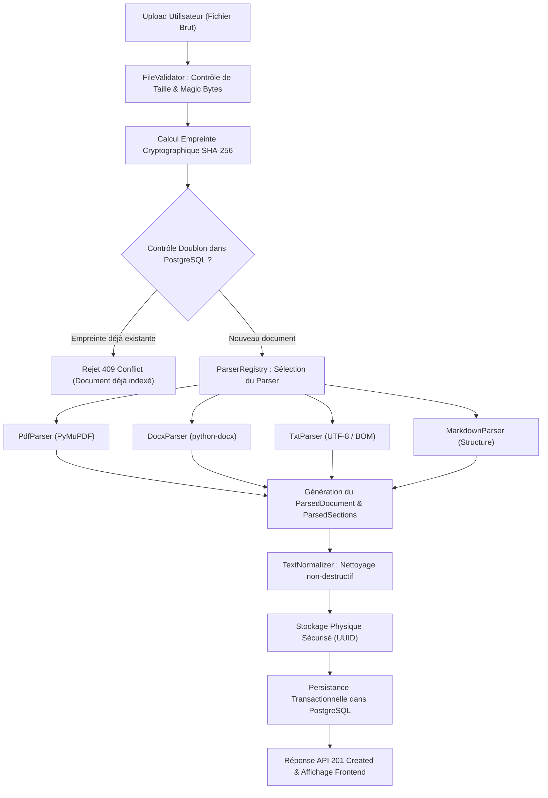

# Tutoriel 02 : Ingestion et Parsing Documentaire Multi-Formats

L'ingestion documentaire constitue la première étape critique de tout pipeline de **Génération Augmentée par Récupération** (RAG). Ce tutoriel explore en profondeur la mécanique de transformation d'un fichier brut (PDF, DOCX, TXT, Markdown) en sections structurées et exploitables.

---

## 1. Schéma de la Chaîne d'Ingestion

Voici le flux d'exécution implémenté dans `backend/app/rag/ingestion/` :



---

## 2. Parsing vs OCR : La Distinction Cruciale

Une confusion fréquente consiste à croire que tout fichier PDF ou image peut être lu directement par un parseur textuel standard :

- **Le Parsing Direct (Programmé)** : Extrait les flux d'instructions textuelles encodées dans le fichier (glyphes de polices, coordonnées vectorielles, chaînes de caractères). C'est ultra-rapide (quelques millisecondes par page) et sans perte d'information textuelle.
- **L'OCR (Reconnaissance Optique de Caractères)** : S'applique lorsque le document est une image numérisée (un scan) sans flux de texte sous-jacent. Un réseau de neurones de vision par ordinateur analyse les pixels pour reconnaître les formes des lettres. C'est beaucoup plus lent, coûteux en calcul et sujet aux erreurs de lecture (ex: confondre `0` et `O`, ou `1` et `l`).

> **Notre règle d'or d'ingénierie :** Si un PDF contient des pages scannées sans texte, notre `PdfParser` émet un avertissement explicite `OCR_REQUIRED` et ne prétend jamais frauduleusement avoir exécuté un OCR.

---

## 3. Pourquoi l'Extraction PDF est-elle Difficile ?

Le format PDF (*Portable Document Format*) a été inventé par Adobe pour **l'affichage et l'impression**, et non pour le traitement sémantique.
Dans un PDF :
- Il n'existe pas de concept de « paragraphe » ou de « phrase ».
- Le fichier contient des instructions de dessin : *« Place le caractère 'B' aux coordonnées (x=120, y=450), puis le caractère 'o' à (x=128, y=450) »*.
- **Multi-colonnes** : Dans un article à deux colonnes, une lecture naïve ligne par ligne lit la ligne 1 de la colonne gauche suivie de la ligne 1 de la colonne droite, produisant un texte totalement inintelligible.

Notre implémentation avec **PyMuPDF** (`fitz`) utilise l'extraction par blocs géométriques ordonnés (`page.get_text("blocks")`), préservant l'ordre de lecture séquentiel naturel et associant chaque bloc à son numéro de page exact.

---

## 4. Exemple Concret : Entrée vs Sortie

### Exemple 1 : Tableau DOCX extrait en Markdown
**Document d'origine (Word) :**
Un tableau de 2 colonnes et 2 lignes : Clé / Valeur, Dimension / 1536.

**Sortie extraite par `DocxParser` :**
```markdown
| Clé | Valeur |
| --- | --- |
| Dimension | 1536 |
```
*Bénéfice RAG :* La syntaxe Markdown préserve explicitement les délimitations de cellules, permettant au futur modèle d'inférer correctement les relations colonne/ligne.

---

### Exemple 2 : Nettoyage par `TextNormalizer`
**Texte brut extrait (PDF) :**
```text
Le   système   RAG\r\n\r\n\r\n\r\nutilise    des     embeddings.
```

**Texte normalisé :**
```text
Le système RAG

utilise des embeddings.
```
*Bénéfice RAG :* Suppression des espaces horizontaux superflus et unification des sauts de ligne sans détruire l'indentation des blocs de code.

---

## 5. Pourquoi la Qualité d'Ingestion Détermine la Qualité du RAG

Dans les phases suivantes, nous allons :
1. Découper ces textes en morceaux (*chunks*).
2. Calculer un vecteur dense pour chaque morceau.
3. Comparer ces vecteurs avec les questions de l'utilisateur.

Si le texte extrait contient du bruit, des en-têtes mélangés ou des tableaux brisés, les vecteurs d'embeddings seront altérés et la recherche retournera des informations erronées. La rigueur de l'ingestion est la condition *sine qua non* de l'excellence en RAG.
