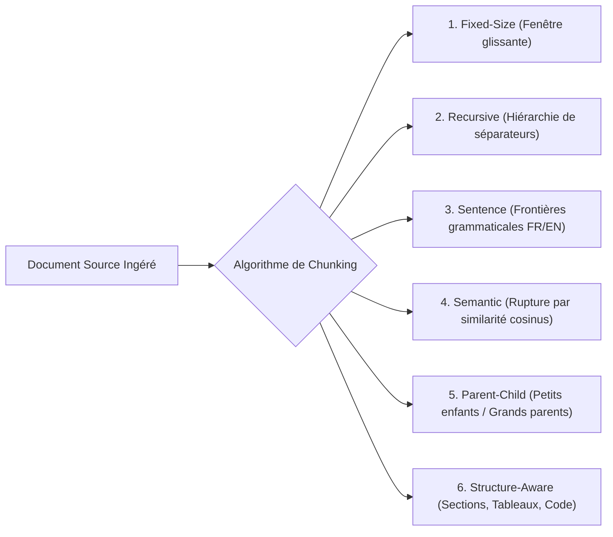
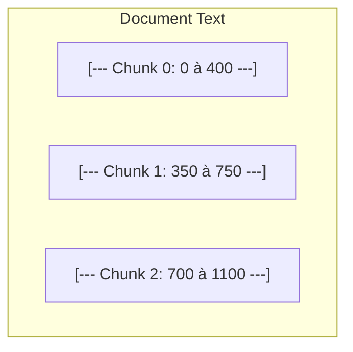
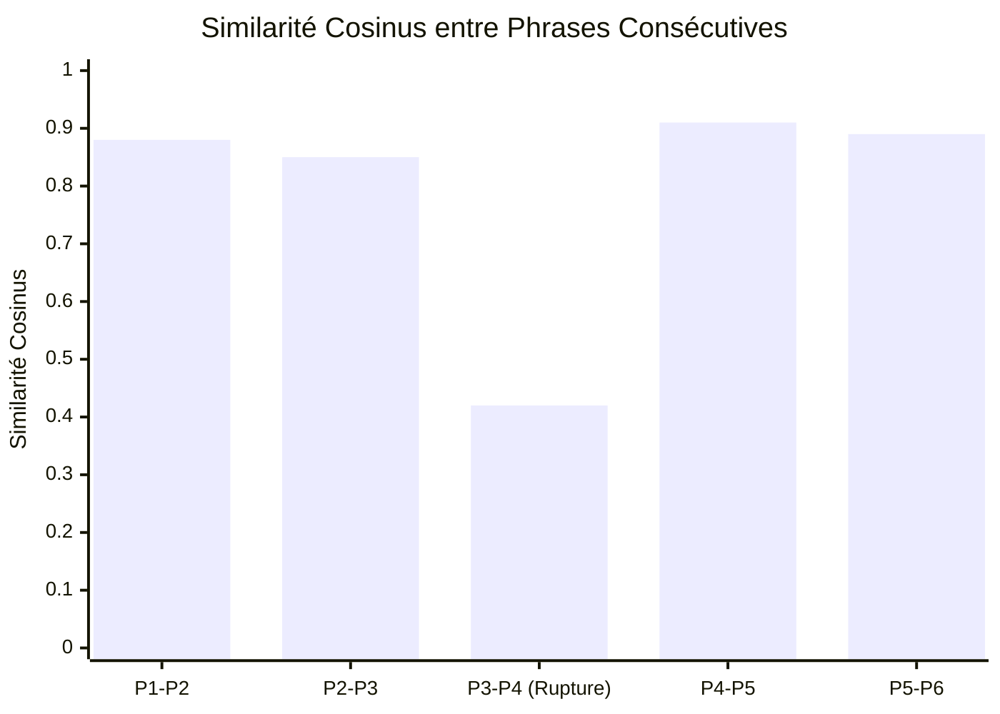
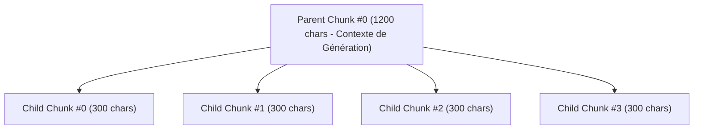

# Tutoriel 03 : Stratégies de Découpage Textuel (Chunking)

Le découpage textuel (*chunking*) est sans doute **l'arbitrage architectural le plus déterminant** de toute la chaîne de Génération Augmentée par Récupération (RAG). Une fois un document ingéré et nettoyé (Phase 02), comment le fragmenter pour maximiser à la fois la précision de la recherche et la fidélité de la synthèse LLM ?

---

## 1. Pourquoi le Découpage est-il Indispensable ?

Un document brut (contrat de 50 pages, documentation technique, livre) ne peut pas être indexé comme un bloc unique pour trois raisons fondamentales :

1. **La dilution de l'embedding (Vector Dilution)** : Un modèle d'embedding condense l'intégralité du texte en un vecteur unique de dimensions fixes (ex. 384, 768 ou 1536 dimensions). Si le texte fait 10 000 mots, les détails spécifiques sont "écrasés" et la similarité cosinus avec une question ciblée s'effondre.
2. **Le budget de la fenêtre de contexte** : Même si les LLMs récents acceptent des fenêtres étendues, injecter des dizaines de pages inutiles augmente le coût de calcul, la latence et le risque de « perte au milieu » (*Lost in the Middle*).
3. **Le compromis fondamental Précision vs Contexte** :
   - **Petits chunks (ex. 100-200 tokens)** : Haute précision de recherche sémantique, mais risque de tronquer une explication essentielle.
   - **Grands chunks (ex. 800-1500 tokens)** : Contexte narratif riche, mais bruit informationnel et score de similarité abaissé.



---

## 2. Caractères vs Tokens

Une erreur fréquente consiste à confondre la longueur en **caractères** (chaînes UTF-8) et la longueur en **tokens** (unités BPE des modèles de langage) :
- En anglais standard : 1 token correspond en moyenne à ~4 caractères (ou ~0,75 mot).
- En français : À cause des accents (`é`, `è`, `à`) et des préfixes/suffixes, le ratio est souvent plus élevé (~1 token pour 3 à 3,5 caractères).
- En code ou données techniques : Les symboles spéciaux créent un nombre élevé de sous-tokens.

> Dans notre laboratoire, le `TokenizerService` supporte le comptage exact de tokens via BPE (`cl100k_base`), permettant de configurer des budgets en tokens réels.

---

## 3. Étude Approfondie des 6 Stratégies Implémentées

### Stratégie A : Découpage à Taille Fixe (*Fixed-Size Window*)

#### Principe Conceptuel
Découpe le texte de manière rigide tous les $N$ caractères ou tokens, avec un chevauchement (*overlap*) de $K$ unités.



#### Exemple Concret
- **Entrée** : `"Le système RAG combine la recherche vectorielle et la synthèse générative."`
- **Config** : `chunk_size = 35`, `chunk_overlap = 10`.
- **Sortie** :
  - Chunk 0 : `"Le système RAG combine la recherche"`
  - Chunk 1 : `"recherche vectorielle et la synthè"`
  - Chunk 2 : `"la synthèse générative."`

#### Compromis & Limites
- **Complexité** : $\mathcal{O}(N)$ ultra-rapide et déterministe.
- **Quand l'utiliser** : Textes continus homogènes, logs, benchmarking de base.
- **Limites** : Coupe impitoyablement les mots, les phrases et les tableaux en plein milieu.

---

### Stratégie B : Découpage Récursif (*Recursive Character Splitter*)

#### Principe Conceptuel
Tente de découper le texte en cascade selon une liste ordonnée de séparateurs naturels :
1. Paragraphes : `"\n\n"`
2. Lignes : `"\n"`
3. Phrases : `". "`
4. Mots : `" "`
5. Caractères individuels : `""`

Puis fusionne les morceaux adjacents jusqu'à atteindre la taille cible, en préservant le chevauchement configuré.

#### Exemple Concret
- **Entrée** :
  ```text
  Chapitre 1. Le modèle encode les données.
  
  Chapitre 2. L'indexation stocke les vecteurs.
  ```
- **Résultat** : Les paragraphes séparés par `\n\n` sont préservés intacts dans des chunks distincts sans casser les phrases.

#### Compromis & Limites
- **Complexité** : $\mathcal{O}(N \log N)$ liée à la décomposition récursive.
- **Quand l'utiliser** : Le choix polyvalent par excellence pour la prose, les articles et la documentation générale.

---

### Stratégie C : Découpage par Phrases (*Sentence-Based*)

#### Principe Conceptuel
S'appuie sur une segmentation grammaticale des phrases, respectant les règles linguistiques françaises et anglaises. Les abréviations (*M., Mme., Dr., e.g., i.e.*), les décimales (*3,14*) et les citations ne provoquent pas de rupture intempestive. Les phrases complètes sont ensuite regroupées jusqu'au budget limite.

#### Exemple Concret
- **Entrée** : `"Le Dr. Martin et Mme. Dupont valident l'architecture. La précision est de 95,2%. Tout fonctionne."`
- **Résultat** : La phrase 1 avec ses deux abréviations et la décimale de la phrase 2 restent parfaitement intègres.

#### Compromis & Limites
- **Quand l'utiliser** : Textes juridiques, médicaux ou littéraires où la proposition grammaticale complète est la brique sémantique minimale.

---

### Stratégie D : Découpage Sémantique (*Semantic Similarity*)

#### Principe Conceptuel
Calcule un vecteur d'embedding pour chaque phrase, puis évalue la similarité cosinus entre phrases consécutives :
$$d_i = 1 - \cos(\mathbf{e}_i, \mathbf{e}_{i+1})$$

Lorsque la distance sémantique dépasse un seuil (*threshold*), cela indique une rupture thématique (changement de sujet). Le système coupe alors le texte à cet endroit précis.



#### Compromis & Limites
- **Complexité** : Nécessite une passe d'inférence neuronale (SentenceTransformers ou modèle local).
- **Quand l'utiliser** : Documents composites abordant successivement des thèmes très hétérogènes (ex. compte-rendu de réunion, revue de presse).

---

### Stratégie E : Hiérarchie Parent-Child

#### Principe Conceptuel
Résout la contradiction entre recherche et contexte en découplant les deux unités :
- **Enfants (Child Chunks, ex. 250 caractères)** : Indexés pour la recherche vectorielle. Leur petite taille garantit une haute spécificité sémantique.
- **Parents (Parent Chunks, ex. 1200 caractères)** : Liés aux enfants par une clé étrangère `parent_chunk_id`. Lors de la génération, lorsqu'un enfant est récupéré, c'est son **parent complet** qui est transmis au LLM.



---

### Stratégie F : Découpage Sensible à la Structure (*Structure-Aware*)

#### Principe Conceptuel
Exploite directement les métadonnées de section extraites lors de la Phase 02 (PyMuPDF et python-docx) :
- Les **tableaux** sont traités comme des blocs atomiques : le découpeur refuse de trancher un tableau au milieu des lignes, ce qui détruirait sa lisibilité.
- Les **blocs de code** (` ``` `) restent intacts.
- Les chunks héritent des titres de chapitres (`heading`) et des numéros de page exacts.

---

## 4. Métriques d'Évaluation du Découpage

Pour comparer scientifiquement deux découpages, notre laboratoire calcule les métriques suivantes :
1. **Ratio de duplication textuelle** : $\frac{\sum \text{len}(\text{chunks}) - \text{len}(\text{texte source})}{\text{len}(\text{texte source})}$. Mesure le surcoût de stockage et de tokens causé par l'overlap.
2. **Écart de taille (Min / Max / Médiane / P90)** : Détecte les morceaux minuscules (bruit) ou démesurés (saturation de contexte).
3. **Chevauchement observé vs nominal** : Vérifie si le chevauchement configuré correspond réellement à des répétitions de sous-chaînes dans les fragments produits.
