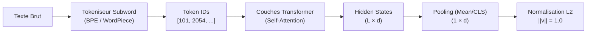
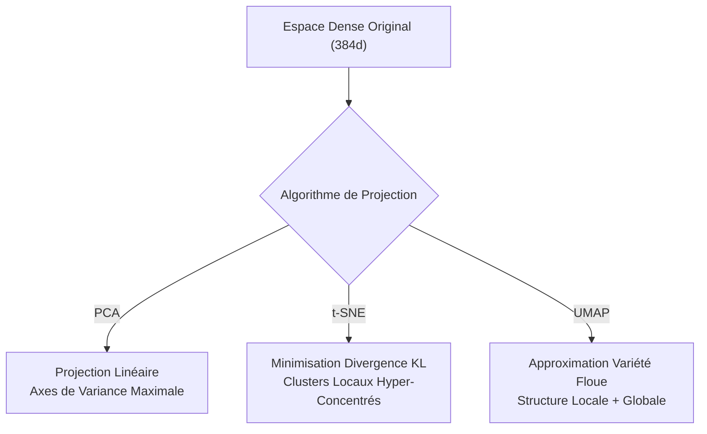

# Tutoriel : Ingénierie des Plongements Vectoriels (Embeddings) et Géométrie Sémantique

Bienvenue dans le laboratoire du **Module 04 : Ingénierie des Embeddings**.
Ce module explore la transformation du langage naturel en représentations géométriques denses continues, la formalisation mathématique de la similarité sémantique, et les techniques de réduction dimensionnelle.

---

## 1. Des Mots aux Espaces Vectoriels Denses

### 1.1 Limites des Représentations Lexicales Creuses (One-Hot & TF-IDF)
Dans les approches lexicales classiques (One-Hot, TF-IDF, BM25) :
- Chaque mot du dictionnaire correspond à un axe orthogonal indépendant.
- Le produit scalaire de deux mots distincts synonymes (ex: *« automobile »* et *« voiture »*) vaut exactement zéro ($\mathbf{u} \cdot \mathbf{v} = 0$).
- Le vocabulaire s'étend sur des dizaines de milliers de dimensions, créant des matrices éparses (*sparse matrices*) inefficaces et aveugles aux relations sémantiques sous-jacentes.

### 1.2 La Révolution des Embeddings Denses
Un **embedding dense** est une fonction $f: \mathcal{T} \to \mathbb{R}^d$ projetant une chaîne textuelle vers un espace vectoriel continu de dimension fixe (généralement $d \in \{384, 768, 1024, 1536\}$).

$$
\mathbf{e} = [v_1, v_2, \dots, v_d] \in \mathbb{R}^d
$$

Chaque dimension ne code pas un mot isolé, mais un axe latent de signification (syntaxe, registre de langue, thématique, polarité, granularité technique).

---

## 2. Le Mécanisme d'Extraction : Attention et Pooling

### 2.1 Les Représentations Contextuelles par Token
Le modèle Transformer (ex: BERT, MiniLM, RoBERTa) produit une matrice de sortie $\mathbf{H} \in \mathbb{R}^{L \times d}$ où chaque ligne $\mathbf{h}_i$ est l'état caché du $i$-ème token après passage à travers $N$ couches d'attention multi-têtes.

### 2.2 Stratégies d'Agrégation (Pooling)
Pour obtenir un unique vecteur par document ou fragment de texte, une étape de réduction est nécessaire :

1. **Mean Pooling (Recommandé pour SentenceTransformers)** :
   Moyenne pondérée des états cachés sur tous les tokens non masqués :
   $$\mathbf{v}_{\text{mean}} = \frac{\sum_{i=1}^{L} m_i \cdot \mathbf{h}_i}{\sum_{i=1}^{L} m_i}$$
   où $m_i \in \{0, 1\}$ est le masque d'attention (*attention mask*).

2. **CLS Token Pooling** :
   Utilisation directe du premier token spécial `[CLS]` :
   $$\mathbf{v}_{\text{cls}} = \mathbf{h}_0$$
   Efficace pour les tâches de classification, mais souvent moins performant pour la recherche dense sans fine-tuning contrastif adapté.

---

## 3. Mathématiques des Métriques de Similarité et Distance

### 3.1 Produit Scalaire (Dot Product)
Mesure la somme des produits composante par composante :

$$\mathbf{u} \cdot \mathbf{v} = \sum_{i=1}^{d} u_i v_i$$

- **Propriété** : Sensible à la magnitude des vecteurs ($\|\mathbf{u}\|$ et $\|\mathbf{v}\|$). Deux textes longs avec des vecteurs de grande norme peuvent obtenir un score élevé sans être sémantiquement plus proches.

### 3.2 Similarité Cosinus (Cosine Similarity)
Normalise le produit scalaire par le produit des normes euclidiennes :

$$\cos(\mathbf{u}, \mathbf{v}) = \frac{\mathbf{u} \cdot \mathbf{v}}{\|\mathbf{u}\|_2 \|\mathbf{v}\|_2} = \frac{\sum_{i=1}^d u_i v_i}{\sqrt{\sum_{i=1}^d u_i^2} \sqrt{\sum_{i=1}^d v_i^2}}$$

- **Bornes** : $[-1.0, 1.0]$.
- **Interprétation** : Indépendant de la longueur textuelle brute.

### 3.3 Distance Euclidienne (L2 Distance)
Mesure la distance géométrique directe entre les extrémités des vecteurs :

$$d_{\text{L2}}(\mathbf{u}, \mathbf{v}) = \|\mathbf{u} - \mathbf{v}\|_2 = \sqrt{\sum_{i=1}^d (u_i - v_i)^2}$$

- **Différence Fondamentale** : La distance euclidienne est une **distance** ($0$ = identité parfaite, des valeurs plus grandes indiquent un éloignement), alors que le cosinus est une **similarité**.

### 3.4 Équivalence lors de la Normalisation L2
Lorsque deux vecteurs sont normalisés sur la sphère unitaire ($\|\mathbf{u}\|_2 = \|\mathbf{v}\|_2 = 1.0$) :

$$d_{\text{L2}}^2(\mathbf{u}, \mathbf{v}) = \|\mathbf{u} - \mathbf{v}\|_2^2 = \|\mathbf{u}\|^2 + \|\mathbf{v}\|^2 - 2 (\mathbf{u} \cdot \mathbf{v}) = 1 + 1 - 2 \cos(\mathbf{u}, \mathbf{v})$$

$$d_{\text{L2}}(\mathbf{u}, \mathbf{v}) = \sqrt{2 \cdot (1 - \cos(\mathbf{u}, \mathbf{v}))}$$

$$\mathbf{u} \cdot \mathbf{v} = \cos(\mathbf{u}, \mathbf{v})$$

> [!TIP]
> **Optimisation de Production** : En normalisant tous les vecteurs au moment de leur indexation dans PostgreSQL (`pgvector`), le calcul de similarité cosinus se réduit à un simple produit scalaire matriciel, accélérant le calcul par un facteur 2 à 4.

---

## 4. Le Problème de l'Anisotropie (Le Phénomène de Cône)

Dans les modèles Transformer pré-entraînés sans affinage contrastif rigoureux :
- Les représentations vectorielles ne sont pas distribuées uniformément dans toutes les directions.
- Elles s'effondrent dans un **cône étroit** (anisotropie).
- Conséquence : deux phrases totalement indépendantes présentent souvent une similarité cosinus de base élevée (ex: 0.40 à 0.60).

**Solution mise en œuvre dans le laboratoire :**
- L'utilisation de modèles contrastifs (SentenceTransformers, InfoNCE loss).
- L'évaluation par **Marge Discriminante** ($\Delta = \mu_{\text{pos}} - \mu_{\text{neg}}$) plutôt que par un seuil cosinus arbitraire.

---

## 5. Réduction Dimensionnelle : PCA, t-SNE et UMAP

Visualiser un espace à $384$ dimensions nécessite des algorithmes de projection 2D :

| Algorithme | Nature | Préservation Principale | Hyperparamètres Clés | Limites Pédagogiques |
| :--- | :--- | :--- | :--- | :--- |
| **PCA** | Linéaire, Déterministe | Variance Globale | Nombre de composantes $k$ | Écrase les variétés non-linéaires complexes |
| **t-SNE** | Non-linéaire, Stochastique | Voisinages Locaux | Perplexité, Taux d'apprentissage | Distances entre clusters non interprétables |
| **UMAP** | Topologique, Non-linéaire | Équilibre Local & Global | $n_{\text{neighbors}}$, $min_{\text{dist}}$ | Déformation d'échelle locale |

---

## 6. Modèles Intégrés dans le Laboratoire

1. **`sentence-transformers/all-MiniLM-L6-v2`** :
   - Dimensions : $384$
   - Tokens Max : $256$
   - Poids : ~80 Mo
   - Spécialité : Anglais, ultra-rapide sur CPU (latence < 10 ms par phrase).

2. **`sentence-transformers/paraphrase-multilingual-MiniLM-L12-v2`** :
   - Dimensions : $384$
   - Tokens Max : $128$
   - Poids : ~470 Mo
   - Spécialité : Multilingue (Français, Anglais, 50+ langues), idéal pour l'alignement bilingue.

3. **`intfloat/multilingual-e5-small`** :
   - Dimensions : $384$
   - Tokens Max : $512$
   - Poids : ~130 Mo
   - Spécialité : Préfixes asymétriques (`query: ` pour requêtes, `passage: ` pour chunks indexés).
