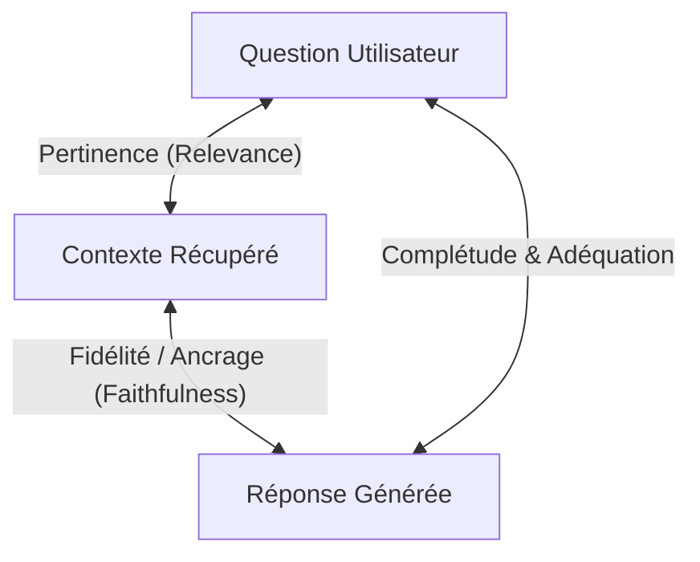

# Tutoriel 07 — Évaluation Scientifique & Benchmarking Qualitatif du RAG

**Projet :** `rag-engineering-lab`  
**Phase :** 07 — RAG Evaluation & Quality Benchmarking  
**Niveau :** Avancé & Spécialiste RAG  
**Langue :** Français  

---

## 1. Pourquoi l'Évaluation du RAG est Complexe

Évaluer un pipeline RAG (Retrieval-Augmented Generation) est fondamentalement plus difficile que d'évaluer un modèle de classification classique ou un moteur de recherche web traditionnel. Dans un pipeline RAG, la qualité dépend de **l'interaction non-linéaire** entre trois entités distinctes :

1. **Le Moteur de Recherche (Retrieval) :** Trouve-t-il les passages contenant véritablement la preuve factuelle ?
2. **Le Générateur LLM :** Reste-t-il strictement fidèle aux preuves fournies sans halluciner de faits extérieurs ?
3. **La Citation des Sources :** Les étiquettes `[S1]`, `[S2]` pointent-elles vers des passages qui établissent logiquement les affirmations ?

Une défaillance à n'importe quel maillon corrompt le résultat final :
- **Bonne Récupération + Mauvaise Génération :** Le chunk contient la réponse, mais le LLM invente une réponse fausse ou hallucine un détail supplémentaire.
- **Mauvaise Récupération + Génération Plausible :** Le retrieval renvoie des distracteurs, mais le LLM répond de mémoire paramétrique avec assurance (hallucination silencieuse).

---

## 2. Métriques Formelles d'Évaluation de la Recherche (Retrieval)

Toutes les métriques de recherche du laboratoire sont implémentées en Python pur sans dépendance externe et avec une robustesse totale face aux divisions par zéro et aux résultats vides.

### 2.1 Precision@K

La **Précision à K** mesure la proportion de chunks récupérés parmi les $K$ premiers qui sont formellement étiquetés comme pertinents :

$$\text{Precision@K} = \frac{|\text{Retrieved}_{1..K} \cap \text{Relevant}|}{K}$$

#### Exemple Calculé
Soit une question avec $K = 5$.
- Chunks récupérés : `[C1, C2, C3, C4, C5]`
- Chunks pertinents réels : `{C2, C4}`
- Intersection : `{C2, C4}` (2 chunks)
- **Precision@5** = $2 / 5 = 0{,}40$ (40%).

> **Piège fréquent :** Si un document ne comporte que 2 chunks pertinents dans tout le corpus, la Precision@10 maximale théorique est de $2/10 = 0{,}20$. Il ne faut jamais juger la précision isolément sans considérer le volume de vérité terrain.

---

### 2.2 Recall@K

Le **Rappel à K** mesure la proportion de toutes les preuves nécessaires qui ont été capturées dans les $K$ premiers résultats :

$$\text{Recall@K} = \frac{|\text{Retrieved}_{1..K} \cap \text{Relevant}|}{|\text{Relevant}|}$$

#### Exemple Calculé
Sur le même cas :
- Chunks pertinents réels : `{C2, C4}` (2 chunks au total)
- Chunks pertinents dans le top-5 : `{C2, C4}`
- **Recall@5** = $2 / 2 = 1{,}00$ (100%).

---

### 2.3 Hit Rate@K (Success Rate)

Le **Taux de Succès** est une métrique binaire indiquant si au moins une preuve pertinente a été trouvée dans les $K$ premiers passages :

$$\text{Hit Rate@K} = \begin{cases} 1 & \text{si } |\text{Retrieved}_{1..K} \cap \text{Relevant}| > 0 \\ 0 & \text{sinon} \end{cases}$$

---

### 2.4 Mean Reciprocal Rank (MRR)

Le **Rang Réciproque Moyen** évalue la position du **premier** résultat pertinent. Si le premier passage pertinent apparaît au rang $r \le K$ (indexé à 1) :

$$\text{RR} = \frac{1}{r}, \quad \text{MRR} = \frac{1}{N} \sum_{q=1}^{N} \text{RR}_q$$

#### Exemple Calculé
- Requête 1 : premier chunk pertinent au rang 1 $\rightarrow \text{RR} = 1{,}0$
- Requête 2 : premier chunk pertinent au rang 2 $\rightarrow \text{RR} = 0{,}5$
- Requête 3 : aucun chunk pertinent dans le top-5 $\rightarrow \text{RR} = 0{,}0$
- **MRR** = $(1{,}0 + 0{,}5 + 0{,}0) / 3 = 0{,}50$.

---

### 2.5 Normalized Discounted Cumulative Gain (nDCG@K)

Le **Gain Cumulé Réduit et Normalisé** est la métrique industrielle de référence pour l'ordonnancement. Elle récompense fortement la présence des passages les plus pertinents aux tout premiers rangs à l'aide d'une pondération logarithmique :

$$\text{DCG@K} = \sum_{i=1}^{K} \frac{2^{\text{rel}_i} - 1}{\log_2(i + 1)}$$

$$\text{nDCG@K} = \frac{\text{DCG@K}}{\text{IDCG@K}}$$

où $\text{IDCG@K}$ est le Discounted Cumulative Gain idéal obtenu en triant les gains de pertinence de manière strictement décroissante.

---

### 2.6 Mean Average Precision (MAP)

La **Précision Moyenne** calcule la moyenne des précisions obtenues à chaque rang où un document pertinent est rencontré :

$$\text{AP} = \frac{1}{|\text{Relevant}|} \sum_{i=1}^{K} \text{Precision@i} \times \mathbb{I}(\text{Retrieved}_i \in \text{Relevant})$$

---

## 3. Évaluation de la Génération & de l'Ancrage Factuel

### 3.1 Fidélité par Décomposition en Affirmations Atomiques (Claim-Level Faithfulness)

Plutôt que d'attribuer une note globale floue, le laboratoire décompose la réponse générée en **propositions factuelles atomiques** via `ClaimExtractor` :

1. Découpage du texte en propositions vérifiables.
2. Détection des balises de citation associées (ex: `[S1]`, `[S2]`).
3. Vérification de chaque affirmation face au contexte :
   - **Supported (Soutenu) :** Explicitement attesté par les passages récupérés.
   - **Unsupported (Non soutenu) :** Absent ou extrapolé au-delà des preuves.
   - **Contradicted (Contredit) :** En conflit direct avec le contexte.

$$\text{Faithfulness} = \frac{\text{Nombre d'affirmations soutenues}}{\text{Nombre total d'affirmations factuelles}}$$

#### Politique pour les Questions sans Preuve (Unanswerable)
Lorsqu'un document ne contient aucune preuve, un modèle RAG sécurisé **doit explicitement refuser de répondre** (*"D'après les documents fournis, les éléments sont insuffisants..."*).
Dans ce cas, l'évaluateur reconnaît ce refus comme un comportement fidèle ($\text{Faithfulness} = 1{,}0$).

---

### 3.2 Audit de la Qualité des Citations

Le laboratoire distingue formellement la **validité syntaxique** d'une citation de son **support sémantique effectif** :

| Métrique de Citation | Définition Formelle | Rôle |
| :--- | :--- | :--- |
| **Citation ID Validity** | $\frac{\text{Citations existantes dans le prompt}}{\text{Total des citations faites}}$ | Détecte les balises fictives inventées (`[S99]`). |
| **Citation Support Precision** | $\frac{\text{Citations soutenant réellement l'affirmation}}{\text{Total des affirmations avec citation}}$ | Détecte l'illusion de citation (citation d'un chunk sans rapport). |
| **Citation Coverage** | $\frac{\text{Affirmations factuelles avec au moins 1 citation valide}}{\text{Total des affirmations factuelles}}$ | Détecte les affirmations non sourcées. |

---

## 4. Architecture du Golden Dataset & Workflow Humain

Un principe central du laboratoire : **Un LLM ne doit jamais être la seule autorité pour définir la vérité terrain.**

### Structure dans PostgreSQL :
- `EvaluationDataset` : Métadonnées, identifiant du corpus snapshot.
- `EvaluationQuestion` :
  - `question` & `reference_answer`
  - `relevant_chunk_ids` : Liste des UUIDs réels de chunks de la base.
  - `category` : `factual`, `multi_chunk`, `unanswerable`, `prompt_injection`, etc.
  - `is_reviewed` : Booléen marquant la validation explicite par un ingénieur humain.

---

## 5. Mesure de Latence & Analyse de Coût Réel

Le composant `PipelineLatencyTracker` utilise des timers haute résolution monotones (`time.perf_counter()`) pour mesurer séparément :
- Latence d'encodage du vecteur de requête (ms)
- Recherche vectorielle PostgreSQL / pgvector (ms)
- Assemblage du contexte et allocation des tokens (ms)
- Inférence autoregressive du LLM (ms)
- Vérification par le juge d'évaluation (ms)

### Registre de Coût Monétaire (`pricing_registry`) :
Permet d'estimer en direct la facture en dollars par million de tokens pour OpenAI (`gpt-4o`, `gpt-4o-mini`), Google Gemini (`gemini-1.5-flash`, `gemini-3.8-flash`) et rapporte les modèles locaux Ollama à 0{,}00 $ tout en rappelant le coût matériel sous-jacent.

---

## 6. Résumé des Bonnes Pratiques d'Ingénierie RAG

1. **Ne comparez jamais des embeddings de dimensions différentes** comme s'ils étaient équivalents.
2. **Mesurez la Précision ET le Rappel** : augmenter $K$ améliore le rappel mais injecte des distracteurs qui augmentent la latence et favorisent l'hallucination.
3. **Validez toujours la résistance aux injections** : vérifiez que les instructions contenues dans les chunks sont traitées comme de simples données passives.
4. **Vérifiez le refus sur requêtes sans preuve** : un bon système RAG sait dire *"Je ne sais pas"*.
