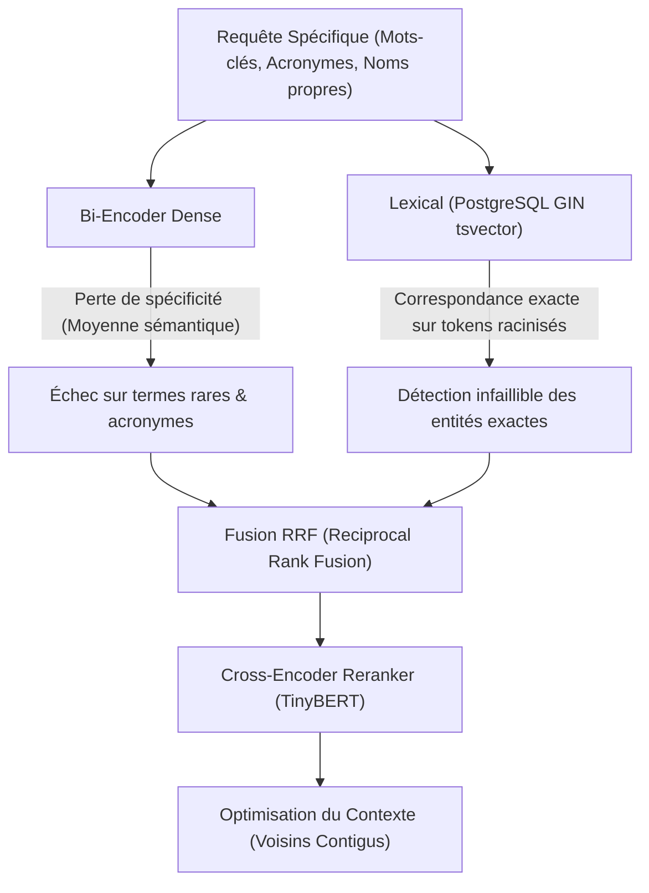
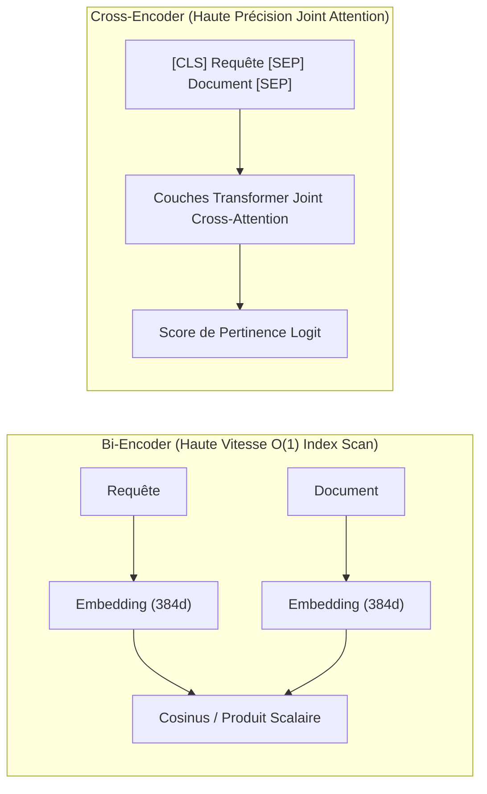

# Tutoriel 08 — Recherche Avancée, Recherche Hybride & Optimisation RAG

**Projet :** `rag-engineering-lab`  
**Phase :** 08 — Advanced Retrieval, Hybrid Search & RAG Optimization  
**Niveau :** Architecte RAG & Ingénieur Recherche d'Information  
**Langue :** Français  

---

## 1. Pourquoi la Recherche Dense Pure Échoue en Production

Dans les architectures RAG dites « naïves » (telles qu'étudiées dans la Phase 06), le module de recherche repose exclusivement sur un modèle d'embedding bi-encoder (ex. `all-MiniLM-L6-v2`) et un index vectoriel pgvector (Exact KNN, HNSW ou IVFFlat).

Bien que la recherche vectorielle dense excelle à capturer la synonymie et la proximité sémantique générale (*« comment améliorer l'extensibilité d'un système »* $\approx$ *« concevoir des architectures distribuées hautement scalables »*), elle souffre de limitations mathématiques et pratiques majeures en environnement d'ingénierie réel :



### Les 4 Écueils du Dense Retrieval Pur

1. **Le Problème du Vocabulaire Hors-Distribution (OOD) :**  
   Les bi-encoders écrasent le texte dans un espace continu de dimension fixe (ex. 384 dimensions). Si une requête contient un identifiant unique, un acronyme technique précis (`Kafka`, `Raft`, `mTLS`, `CVE-2024-1234`), la représentation vectorielle dense noie ce terme rare au milieu du contexte sémantique global.
2. **L'Incapacité à Traiter les Négations et Règles Booléennes Strictes :**  
   Pour un espace vectoriel dense, la phrase *« candidat sans expérience en Java »* a une similarité cosinus extrêmement élevée avec *« candidat avec 10 ans d'expérience en Java »*, car la distribution lexicale globale est quasi identique.
3. **L'Effet « Lost in the Middle » :**  
   Si les chunks récupérés ne sont pas reclassés selon une attention croisée requête-document, le LLM accorde une attention disproportionnée aux chunks placés tout au début et tout à la fin de la fenêtre de contexte.
4. **La Fragmentation des Preuves Trans-Chunks :**  
   Quand une explication ou une liste de compétences est scindée arbitrairement par la fenêtre de découpage, un chunk unique ne contient qu'une demi-preuve, dégradant le Recall@K.

---

## 2. Recherche Plein Texte Lexicale avec PostgreSQL (TSVector & GIN)

Pour compléter la recherche vectorielle, nous exploitons le moteur de recherche plein texte natif de PostgreSQL via les types `tsvector` et `tsquery`, accélérés par un index GIN (*Generalized Inverted Index*).

### 2.1 Architecture de Stockage : Colonne Générée `tsv_content`

Au lieu de calculer la racinisation (*stemming*) à la volée lors de chaque requête, nous créons une colonne générée persistée dans la table `document_chunks` :

```sql
ALTER TABLE document_chunks
ADD COLUMN tsv_content tsvector
GENERATED ALWAYS AS (to_tsvector('english', coalesce(content, ''))) STORED;

CREATE INDEX idx_document_chunks_tsv_content
ON document_chunks USING gin (tsv_content);
```

### 2.2 Formats de Requêtes : `plainto_tsquery` vs `websearch_to_tsquery`

- `plainto_tsquery('english', :query)` transforme une phrase naturelle en conjonctions logiques `token1 & token2 & token3` après élimination des mots vides (*stopwords*) et application de l'algorithme de Porter.
- Pour évaluer la pertinence lexicale avec densité des termes, nous utilisons la fonction `ts_rank_cd` avec normalisation logarithmique (flag 32) :

```sql
SELECT 
    id,
    content,
    ts_rank_cd(tsv_content, plainto_tsquery('english', :query), 32) AS lexical_score
FROM document_chunks
WHERE tsv_content @@ plainto_tsquery('english', :query)
ORDER BY lexical_score DESC
LIMIT :top_k;
```

---

## 3. Méthodes de Fusion : Combinaison Linéaire vs. RRF

Lorsque deux canaux de recherche (Dense pgvector et Lexical GIN) produisent chacun une liste ordonnée de candidats, comment fusionner leurs résultats ?

### 3.1 Combinaison Linéaire Normalisée

La méthode classique applique une somme pondérée des scores :

$$S_{\text{linear}}(d) = \alpha \cdot \hat{S}_{\text{dense}}(d) + (1 - \alpha) \cdot \hat{S}_{\text{lexical}}(d)$$

où $\alpha \in [0, 1]$ est l'hyperparamètre d'arbitrage.

#### Le Problème Fondamental de la Combinaison Linéaire
Les distributions de score sont hétérogènes :
- La similarité cosinus dense est bornée dans $[-1, 1]$ (et typiquement dans $[0{,}4, 0{,}9]$ pour un corpus cohérent).
- Le score `ts_rank_cd` lexical est non borné dans $[0, \infty)$, variant selon la longueur du document et la fréquence du mot-clé.
- Pour combiner ces scores, il faut calculer les min et max locaux sur la volée ($\hat{S} = \frac{S - S_{\min}}{S_{\max} - S_{\min}}$). Cette normalisation Min-Max est fragile : un seul outlier ou un chunk très court avec une haute répétition de mots-clés écrase toute la distribution.

### 3.2 Reciprocal Rank Fusion (RRF) : L'Approche Sans Calibrage

La fusion de rangs réciproques (Cormack et al., SIGIR 2009) s'affranchit totalement des scores numériques pour ne considérer que les **positions de rang** $r_c(d)$ du document $d$ dans chaque canal $c$ :

$$\text{RRF}(d) = \sum_{c \in C} \frac{1}{k + r_c(d)}$$

où :
- $C$ est l'ensemble des canaux (ici, `{dense, lexical}`).
- $r_c(d) \in \{1, 2, 3, \dots\}$ est le rang du document dans le canal $c$ (si un document est absent du canal $c$, $r_c(d) = \infty$, soit un terme nul).
- $k$ est une constante d'adoucissement (*smoothing constant*), traditionnellement fixée à $60$.

#### Démonstration Intuitive du RRF
Soient deux documents $A$ et $B$ avec $k = 60$ :
- **Document A (Spécialiste Dense) :** Classé #1 en Dense ($r_{\text{dense}} = 1$), mais absent du top lexical ($r_{\text{lex}} = \infty$) :
  $$\text{RRF}(A) = \frac{1}{60 + 1} + 0 = \frac{1}{61} \approx 0{,}01639$$
- **Document B (Consensus Équilibré) :** Classé #10 en Dense et #12 en Lexical :
  $$\text{RRF}(B) = \frac{1}{60 + 10} + \frac{1}{60 + 12} = \frac{1}{70} + \frac{1}{72} \approx 0{,}01428 + 0{,}01388 = 0{,}02817$$

Le document $B$ obtient un score presque **deux fois supérieur** à $A$ ($0{,}02817 > 0{,}01639$), car il a fait consensus dans les deux modalités indépendantes !

---

## 4. Re-Ranking Cross-Encoder : Bi-Encoder vs. Cross-Encoder

La recherche dense initiale est effectuée par un **Bi-Encoder** pour des raisons impératives de complexité algorithmique : les embeddings de millions de chunks sont précalculés et indexés indépendamment de la requête.

Cependant, le Bi-Encoder souffre de l'absence d'interactions croisées entre les tokens de la requête et ceux du document lors du calcul de similarité (il n'évalue qu'un simple produit scalaire entre deux vecteurs globaux de 384 dimensions).



### 4.1 Fonctionnement du Cross-Encoder

Le Cross-Encoder prend en entrée la concaténation brute :
$$\text{Input} = \texttt{[CLS]} \circ \text{Requête} \circ \texttt{[SEP]} \circ \text{Passage} \circ \texttt{[SEP]}$$

Toutes les couches d'attention du modèle Transformer comparent chaque mot de la requête à chaque mot du document.

Dans notre laboratoire, nous intégrons le modèle CPU-optimisé :
`cross-encoder/ms-marco-TinyBERT-L-2-v2` (2 couches, ~4.4M paramètres, latence inférieure à 15 ms sur CPU standard).

---

## 5. Traitement Avancé des Requêtes : Multi-Query Expansion

Une question utilisateur courte (ex. *« stack technique backend »*) peut omettre des termes synonymes cruciaux présents dans les documents (*« FastAPI, Python, PostgreSQL, architecture distribuée »*).

Le module `QueryProcessor` implémente :
1. **Extraction de Mots-Clés et Entités :** Détection d'acronymes et mots informatifs via analyse lexicale sans dépendance lourde.
2. **Expansion Multi-Requêtes (Multi-Query Expansion) :** Génération de formulations alternatives focalisées sur différentes facettes de la question.
3. **Fusion Multi-Canaux :** Les candidats récupérés pour chaque sous-requête sont agrémentés dans un pool unique de candidats via RRF.

---

## 6. Optimisation du Contexte (Context Optimization)

La dernière étape du pipeline de recherche avant la génération LLM affine le pool de passages sélectionnés :

1. **Expansion des Voisins Contigus (Contiguous Neighbor Expansion) :**  
   Si le chunk `Seq #4` est sélectionné comme très pertinent, le système récupère automatiquement les chunks `Seq #3` et `Seq #5` du même document pour reconstituer le paragraphe ou le tableau original.
2. **Déduplication Sémantique et Hash-Based :**  
   Élimine les chunks redondants ou quasi-identiques (Jaccard token overlap > 0.85 ou hachage SHA-256 identique) pour ne pas gaspiller le budget de tokens du LLM.
3. **Filtrage Adaptatif par Seuil de Pertinence :**  
   Si le score du 3ème chunk s'effondre de plus de 50% par rapport au 1er chunk, les distracteurs de bas de tableau sont éliminés même si `top_k=5`.

---

## 7. Les 8 Stratégies de Recherche Comparées

| Stratégie | Canaux | Fusion | Re-ranking | Optimisation Contexte | Cas d'Usage Idéal |
| :--- | :--- | :--- | :--- | :--- | :--- |
| `dense_only` | pgvector | Aucune | Aucune | Aucune | Baseline haute vitesse, requêtes purement conceptuelles |
| `lexical_only` | GIN tsvector | Aucune | Aucune | Aucune | Recherche exacte de codes d'erreur, références ou acronymes |
| `hybrid_linear` | Dense + Lexical | Linéaire ($\alpha$) | Aucune | Aucune | Corpus où le poids lexical vs sémantique est finement calibré |
| `hybrid_rrf` | Dense + Lexical | RRF ($k=60$) | Aucune | Aucune | Architecture robuste tout-terrain sans réglage de seuil |
| `dense_rerank` | Dense | Aucune | TinyBERT | Aucune | Grande précision sur requêtes sémantiques complexes |
| `hybrid_rrf_rerank` | Dense + Lexical | RRF ($k=60$) | TinyBERT | Aucune | Système de production haute fidélité |
| `multi_query_hybrid_rerank` | Dense + Lexical | RRF | TinyBERT | Multi-Query | Requêtes utilisateur vagues, implicites ou sous-spécifiées |
| `adaptive_context` | Dense + Lexical | RRF | TinyBERT | Voisins + Dédup | Documents techniques longs, listes découpées, tableaux |

---

## 8. Synthèse Pédagogique

L'intégration d'un pipeline de recherche hybride RRF + Reranker transforme un système RAG :
- Le **Rappel (Recall@K)** progresse nettement en éliminant les angles morts du dense retrieval.
- La **Précision du premier résultat (MRR et nDCG)** augmente grâce à l'attention conjointe du Cross-Encoder.
- L'**ancrage factuel du LLM** s'améliore directement, car le prompt ne reçoit que des preuves dédupliquées, ordonnées et complétées de leur contexte voisin immédiat.
