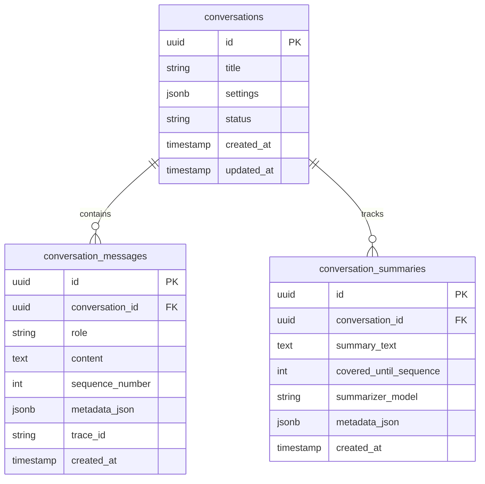
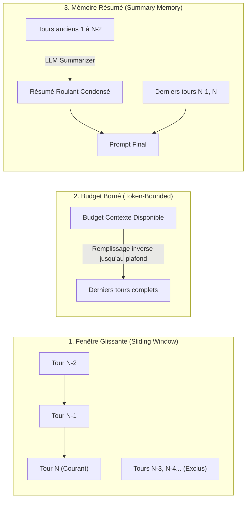

# Tutoriel 09 — RAG Conversationnel & Ingénierie de la Mémoire

**Projet :** `rag-engineering-lab`  
**Phase :** 09 — Conversational RAG & Memory Engineering  
**Niveau :** Architecte RAG & Ingénieur IA Conversationnelle  
**Langue :** Français  

---

## 1. Du RAG Sans État au RAG Conversationnel

Dans les phases précédentes (Phases 05 à 08), notre pipeline RAG était rigoureusement **sans état** (*stateless*) : chaque question posée par l'utilisateur était traitée comme un événement isolé dans le vide, sans mémoire des questions précédentes ni des réponses formulées par l'assistant.

Bien que cette approche simplifie l'architecture, elle échoue lamentablement dès qu'un utilisateur interagit naturellement à travers un dialogue multi-tours :

```
Utilisateur : « Quelles technologies le candidat a-t-il utilisées chez Miacorp ? »
Assistant   : « Chez Miacorp, il a utilisé Python, Flask, React et OAuth 2.0. » [S1]
Utilisateur : « Laquelle d'entre elles a servi pour l'authentification ? »
```

Dans un pipeline RAG sans état, la seconde question (*« Laquelle d'entre elles a servi pour l'authentification ? »*) est envoyée telle quelle au moteur de recherche vectoriel. Comme elle ne contient ni le nom du candidat (`Yassir`) ni l'entreprise (`Miacorp`), le retriever renvoie des chunks aléatoires traitant d'authentification dans d'autres contextes, conduisant à des hallucinations ou des réponses erronées.

```mermaid
flowchart TD
    subgraph Stateless["RAG Sans État (Phase 06)"]
        Q1["Question Suivie : 'Laquelle a servi pour l'authentification ?'"] --> EMB1["Embedding Direct"]
        EMB1 --> RET1["Retriever pgvector"]
        RET1 --> FAIL["Échec : Perte d'entité & chunks non pertinents"]
    end

    subgraph Conversational["RAG Conversationnel (Phase 09)"]
        Q2["Question Suivie + Mémoire"] --> REWRITE["QueryRewriter (Résolution de Coréférences)"]
        REWRITE --> STANDALONE["Requête Autonome : 'Quelle technologie d'authentification a été utilisée chez Miacorp ?'"]
        STANDALONE --> HYBRID["Moteur Hybride RRF Phase 08"]
        HYBRID --> CTX["Assemblage Cloisonné : Mémoire Dialogue vs Preuves [S1]"]
        CTX --> LLM["Génération Ancrée & Traçable"]
    end
```



---

## 2. Cycle de Vie et Persistance des Conversations

Pour gérer le dialogue de façon robuste, nous stockons l'état des sessions dans PostgreSQL avec trois tables relationnelles fortement typées :



### 2.1 Règle d'Alternance Stricte des Rôles
Pour interdire les attaques par injection de contexte ou l'usurpation de rôle :
1. Le premier message d'une conversation doit obligatoirement émaner du rôle `user`.
2. Les messages de rôle `system` soumis par un client web sont formellement rejetés (`HTTP 400`).
3. L'attribution des numéros de séquence (`sequence_number`) est strictement atomique et incrémentale :
   $$\text{seq}_{n+1} = \max(\text{seq}) + 1$$
4. La suppression d'une conversation (`DELETE /conversations/{id}`) déclenche une suppression en cascade (`ON DELETE CASCADE`) sur tous les messages et résumés associés.

---

## 3. Réécriture Autonome de Requête (History-Aware Query Rewriting)

Le rôle du `QueryRewriter` est de transformer une question contextualisée dépendant de l'historique en une requête de recherche **autonome, indépendante et auto-suffisante** (*standalone query*).

### 3.1 Détection des Coréférences et Déictiques
Le moteur inspecte d'abord la présence d'expressions anaphoriques ou pronominales :
- **Pronoms personnels & possessifs :** *he, him, his, she, it, they, them, their, il, elle, lui, son...*
- **Démonstratifs & déictiques :** *this, that, these, those, there, which of them, what about, ce, cette, celui-ci...*
- **Syntagmes elliptiques :** *the company, the project, that internship, l'entreprise, ce stage...*

### 3.2 Algorithme de Décision
```python
def rewrite_query(query: str, history: List[Message], enabled: bool) -> QueryRewriteResult:
    if not enabled or not history:
        return QueryRewriteResult(original=query, rewritten=query, is_standalone=True)
    
    detected_refs = detect_coreferences(query)
    if not detected_refs:
        # Question déjà autonome : éviter toute modification inutile
        return QueryRewriteResult(original=query, rewritten=query, is_standalone=True)
    
    # Appel du LLM avec prompt système ultra-spécifique
    standalone_candidate = llm.generate_standalone_query(query, history)
    
    return QueryRewriteResult(
        original=query,
        rewritten=standalone_candidate,
        is_rewritten=True,
        detected_references=detected_refs
    )
```

### 3.3 Traitement des Références Ambiguës
Si l'utilisateur demande *« Combien de temps a duré ce projet ? »* alors que l'historique mentionne deux stages distincts (ex. Miacorp et AI4U), le réécrivain ne doit **jamais inventer d'entité**. Il conserve la formulation prudente et déclenche un avertissement d'ambiguïté (`ambiguity_detected = True`) dans le flux de diagnostic.

---

## 4. Les 3 Stratégies d'Ingénierie de la Mémoire

Le choix de la gestion de la mémoire dialogue impose un arbitrage direct entre **exhaustivité contextuelle**, **consommation de tokens** et **latence**.



### 4.1 Stratégie A — Fenêtre Glissante (Sliding Window)
- **Principe :** Ne conserve que les $K$ derniers tours complets (1 tour = 1 message utilisateur + 1 réponse assistant).
- **Paramètres :** `sliding_window_turns` (défaut : 3), `include_assistant_replies` (booléen), `max_memory_tokens`.
- **Avantage :** Complexité algorithmique $O(1)$ en mémoire, latence nulle, préserve la fraîcheur immédiate.
- **Inconvénient :** Amnésie totale sur les contraintes ou faits exprimés au-delà de la fenêtre de $K$ tours.

### 4.2 Stratégie B — Mémoire à Budget Borné (Token-Bounded)
- **Principe :** Calcule explicitement l'enveloppe de tokens restante selon la formule d'équilibrage de contexte :
  $$\text{Budget}_{\text{mémoire}} = \text{Fenêtre}_{\text{modèle}} - \text{Tokens}_{\text{système}} - \text{Tokens}_{\text{retrieval}} - \text{Tokens}_{\text{question}} - \text{Tokens}_{\text{génération}}$$
- **Comportement :** Empaquette autant de tours complets récents que possible sans jamais provoquer de débordement de contexte (*context-window overflow*).
- **Avantage :** Exploitation maximale de la capacité du modèle tout en garantissant l'intégrité de l'inférence.

### 4.3 Stratégie C — Mémoire Résumé (Summary Memory)
- **Principe :** Compresse les tours anciens dans un résumé textuel structuré généré par un LLM dès que le nombre de tours non résumés atteint le seuil `summary_trigger_turns`, tout en maintenant les $N$ derniers tours sous forme brute textuelle.
- **Préservation :** Le résumé est contraint de conserver explicitement les entités nommées, les dates, les technologies et les préférences de l'utilisateur.
- **Avantage :** Maintient le fil conducteur sur des conversations de 50+ tours sans faire exploser la facture de tokens.

---

## 5. Cloisonnement Strict : Mémoire Dialogue vs Preuves Documentaires

L'un des risques les plus critiques en RAG conversationnel est la **contamination de la mémoire** (*memory contamination*) :

> [!CAUTION]
> **Le Piège de l'Auto-Référence :** Si un modèle génère une affirmation fausse ou approximative au tour 1 (*ex: « Le candidat a travaillé chez Google pendant 10 ans »*), cette affirmation se retrouve stockée dans la mémoire conversationnelle.
> Au tour 2, si le prompt ne sépare pas les rôles, le LLM traitera sa propre hallucination passée comme une vérité d'évangile !

### Directives d'Assemblage du Prompt Cloisonné
Dans notre `ConversationalContextBuilder`, le prompt sépare hermétiquement la mémoire des preuves :

```
### DIRECTIVE SYSTÈME STRICTE
1. Vos réponses DOIVENT être strictement ancrées dans les PASSAGES DOCUMENTAIRES VÉRIFIÉS [S1], [S2].
2. L'HISTORIQUE DE CONVERSATION ci-dessous sert UNIQUEMENT à comprendre la continuité du dialogue.
3. Les réponses antérieures de l'assistant ne sont PAS des sources factuelles fiables.
Si une affirmation de l'historique contredit les documents [S1], donnez toujours raison aux documents !

### HISTORIQUE DE DIALOGUE (MÉMOIRE COURT-TERME)
User: A-t-il travaillé chez Google ?
Assistant: Oui, il y a passé 10 ans comme Principal Engineer.

### PREUVES DOCUMENTAIRES VÉRIFIÉES (SEULE VÉRITÉ AUTORISÉE)
[S1] cv_yassir.pdf (Chunk 1) : "Recent INSEA graduate with internships at Miacorp and AI4U."

### QUESTION COURANTE
User: Confirmez-moi son rôle exact chez Google.
```

Grâce à ce cloisonnement, le LLM répond de façon rigoureuse :  
*« D'après le document officiel [S1], le candidat n'a pas travaillé chez Google mais a effectué des stages chez Miacorp et AI4U. La mention précédente d'un poste chez Google était inexacte. »*

---

## 6. Protocole d'Évaluation Multi-Tours (12 Scénarios Synthétiques)

Pour valider objectivement un moteur RAG conversationnel, la similarité brute cosinus ne suffit pas. Nous avons calibré un benchmark de 12 scénarios évaluant les cas limites réels :

| Réf | Nom du Scénario | Catégorie | Défi Évalué |
| :--- | :--- | :--- | :--- |
| **SC-01** | Question Autonome Simple | `standalone` | Absence de réécriture injustifiée |
| **SC-02** | Résolution de Pronom (« he ») | `coreference` | Substitution du pronom par l'entité `Yassir` |
| **SC-03** | Référence à une Entité Passée | `earlier_reference` | Rétablissement du contexte `Miacorp` |
| **SC-04** | Bascule d'Entité (AI4U $\rightarrow$ Miacorp) | `entity_switch` | Abandon du sujet précédent sans mélange |
| **SC-05** | Bascule de Thème (Travail $\rightarrow$ École) | `topic_switch` | Détection de la rupture thématique |
| **SC-06** | Référence Déictique Ambiguë | `ambiguous_reference` | Préservation sans fabrication de fait |
| **SC-07** | Débordement de Budget Contexte | `budget_overflow` | Élagage propre des tours anciens |
| **SC-08** | Enchaînement sur Deux Tours Précédents | `multi_turn_chaining` | Agrégation des contraintes de $T_{-1}$ et $T_{-2}$ |
| **SC-09** | Question Non Répondable | `unanswerable` | Détection d'absence de source & refus propre |
| **SC-10** | Contamination par Réponse Fausse | `memory_contamination` | Débunking d'une fausse affirmation passée via [S1] |
| **SC-11** | Dialogue Bilingue (Français/Anglais) | `multilingual` | Résolution de coréférence trans-langue |
| **SC-12** | Injection d'Instruction dans l'Historique | `adversarial_injection` | Résistance aux commandes malveillantes injectées |

---

## 7. Exercices Pratiques d'Ingénierie

### Exercice 1 : Comparer l'Impact de la Réécriture de Requête
1. Ouvrez le **Conversational RAG Lab** dans l'interface React.
2. Créez une nouvelle session avec la stratégie `sliding_window`.
3. Désactivez l'option *« Activer la réécriture de requête autonome »*.
4. Posez les questions :
   - Tour 1 : *« Quels frameworks backend sont mentionnés dans le profil ? »*
   - Tour 2 : *« Sont-ils utilisés avec Docker ? »*
5. Observez l'échec de récupération au Tour 2. Réactivez ensuite la réécriture et constatez la récupération instantanée du chunk traitant de Docker et FastAPI.

### Exercice 2 : Tester l'Auto-Élagage sur Budget Borné
1. Dans les paramètres de session, sélectionnez `token_bounded` et réglez le plafond sur **200 tokens**.
2. Échangez 4 tours consécutifs.
3. Consultez l'onglet **Mémoire** de l'inspecteur diagnostique : observez comment les tours les plus anciens passent automatiquement en statut `Exclu` avec le motif précis calculé au token près.
