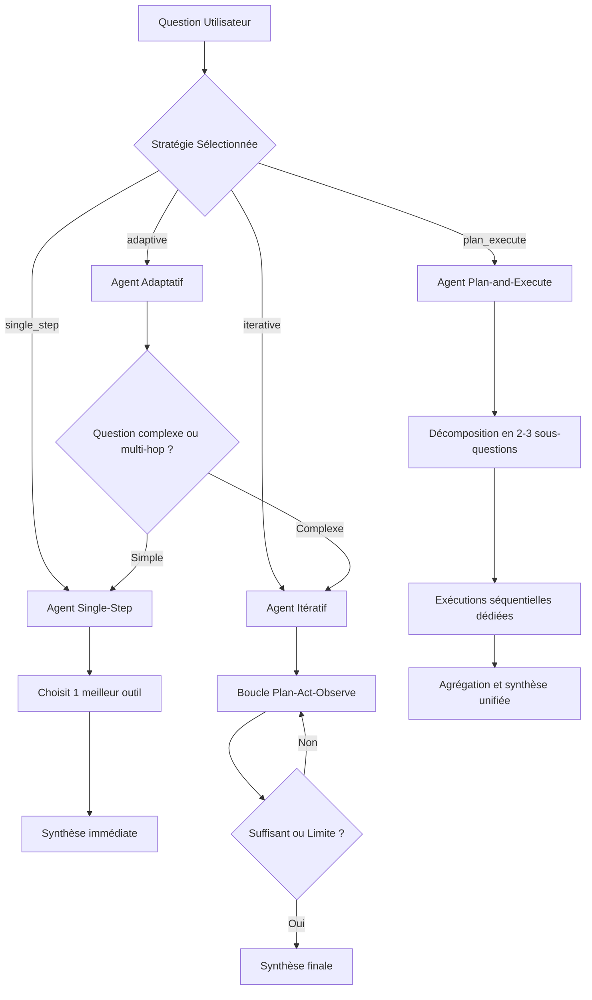

# Tutoriel 10 : RAG Agentique & Récupération Orchestrée par Outils

Bienvenue dans le module **Phase 10 — RAG Agentique & Récupération Orchestrée par Outils** du laboratoire d'ingénierie RAG.

Dans les phases précédentes, nous avons exploré le RAG naïf (Phase 06), la recherche hybride dense/lexicale avec reclassement (Phase 08) et les mémoires conversationnelles avec réécriture autonome (Phase 09). Cependant, tous ces systèmes partageaient une caractéristique fondamentale : **la récupération restait statique et en une seule étape**.

Dans ce tutoriel, nous concevons et déployons un système **RAG Agentique** transparent, contrôlé et strictement contraint, dans lequel le modèle de langage (LLM) agit comme un contrôleur au sein d'une boucle **Planifier – Agir – Observer (Plan–Act–Observe)**.

---

## 1. RAG Standard vs. RAG Agentique

```mermaid
flowchart LR
    subgraph Standard["RAG Standard (Statique)"]
        Q1([Question]) --> R1[Recherche Unique]
        R1 --> D1[Contexte Fixe]
        D1 --> G1[Génération Réponse]
    end

    subgraph Agentic["RAG Agentique (Dynamique & Itératif)"]
        Q2([Question]) --> Ctrl{"Contrôleur Agent"}
        Ctrl -->|1. Plan| Plan[Décomposition / Hypothèse]
        Plan -->|2. Act| Tool[Appel Outil Retreival]
        Tool -->|3. Observe| Obs[Collecte & Analyse Preuve]
        Obs -->|Manque d'info| Ctrl
        Obs -->|Preuve Suffisante| Gen[Synthèse Référencée [S1], [S2]]
    end
```

### La rupture de paradigme
1. **RAG Standard (One-Shot) :** Une requête (même reformulée) interroge le moteur vectoriel une seule fois. Si l'information est répartie sur plusieurs documents disjoints ou nécessite un raisonnement en cascade (multi-hop), le système échoue ou hallucine.
2. **RAG Agentique (Multi-Hop) :** L'agent inspecte la question, formule une première recherche ciblée, observe les extraits retournés, constate les éléments manquants, déclenche une deuxième recherche complémentaire, et ne conclut que lorsque la preuve est jugée suffisante ou que le budget alloué est épuisé.

---

## 2. Délimitation de Sécurité : Sélection d'Outils vs. Exécution Arbitraire

> [!CAUTION]
> **Règle Fondamentale de Sécurité :**
> Un agent RAG sécurisé en production **ne doit jamais générer ni exécuter de code arbitraire** (comme du Bash, du Python non isolé ou du SQL brut) et ne doit jamais définir dynamiquement de nouveaux outils exécutables.

Dans notre architecture :
- **Outils en Liste Blanche Stricte (Allowlist) :** Tous les outils autorisés sont déclarés à la compilation et implémentent un contrat abstrait `BaseAgentTool`.
- **Lecture Seule Absolue (Read-Only) :** Les outils ne peuvent ni modifier la base de données, ni supprimer de documents, ni déclencher d'appels réseau externes non autorisés.
- **Validation Typée par Schéma Pydantic :** Chaque argument fourni par le LLM est validé au caractère près par un schéma strict. Tout argument malformé produit une erreur structurée interceptée sans planter le conteneur.

---

## 3. Le Catalogue des 5 Outils Approuvés

| Nom de l'Outil | Paramètres Clés | Description & Cas d'Usage Idéal |
| :--- | :--- | :--- |
| `dense_search` | `query: str`, `top_k: int`, `filters: dict` | Recherche sémantique par similarité cosinus via pgvector. Idéal pour explorer des concepts abstraits. |
| `hybrid_search` | `query: str`, `strategy: str`, `top_k: int` | Fusion RRF ou linéaire entre index lexical plein texte PostgreSQL (`tsvector`) et pgvector, avec reranking TinyBERT. Recommandé pour termes techniques précis. |
| `read_document_section` | `chunk_id: str`, `document_id: str`, `section_id: str` | Lecture ciblée d'un fragment précis sans réexécuter de recherche vectorielle. Idéal pour inspecter le voisinage immédiat d'une preuve. |
| `inspect_document_metadata` | `document_id: str`, `filename: str` | Inspection des métadonnées (nombre de pages, taille, date, encodage, langue). Ne charge pas les extraits textuels. |
| `inspect_evidence` | `source_ids: list`, `question: str` | Analyseur d'adéquation vérifiant si les extraits déjà collectés couvrent les termes clés de la question. |

---

## 4. Les 4 Stratégies Agentiques



### A. Single-Step Agent (Ligne de Base)
L'agent analyse la question, choisit un outil approprié dans l'allowlist (par exemple `hybrid_search`), observe les résultats et synthétise la réponse. C'est le point de référence pour mesurer le coût d'une décision agentique minimale.

### B. Iterative Retrieval Agent (Boucle Complète)
L'agent évalue l'état actuel de la mémoire de preuve. À chaque itération :
1. Vérification des budgets de sécurité (temps restant, itérations restantes).
2. Décision du LLM (`tool_call` avec arguments typés ou `stop`).
3. Exécution sécurisée de l'outil dans PostgreSQL.
4. Collecte, déduplication et attribution d'identifiants de source stables `[S1]`, `[S2]`.
5. Répétition jusqu'à saturation de la preuve ou atteinte des limites.

### C. Plan-and-Execute Agent (Décomposition Structurée)
Pour les requêtes complexes nécessitant de recouper plusieurs sources :
1. **Planification :** Décomposition de la question en 2 ou 3 sous-questions indépendantes.
2. **Exécution :** Lancement d'outils de recherche ciblés pour chaque sous-question.
3. **Agrégation :** Déduplication globale de toutes les preuves au sein de l'`EvidenceCollector`.
4. **Synthèse :** Réponse unifiée citant avec exactitude les sources documentaires.

### D. Adaptive Routing Agent (Aiguillage Dynamique)
Les requêtes courtes et factuelles ne justifient pas le surcoût en latence d'une boucle multi-étapes. L'agent adaptatif analyse la complexité syntaxique et sémantique :
- Requêtes simples $\rightarrow$ Aiguillage vers `single_step` ($< 80\text{ ms}$).
- Requêtes multi-parties / comparatives $\rightarrow$ Aiguillage vers `iterative` ou `plan_execute`.

---

## 5. Gestion de la Preuve et Intégrité des Citations

L'`EvidenceCollector` résout trois défis majeurs des agents autonomes :

1. **Déduplication au fil de l'eau :** Si plusieurs requêtes successives retournent le même chunk, celui-ci n'est injecté qu'une seule fois dans le prompt de synthèse.
2. **Identifiants Stables `[S#]` :** Chaque preuve distincte reçoit un repère invariable (`[S1]`, `[S2]`, etc.), conservant son nom de document d'origine, son numéro de page et l'outil qui l'a découverte.
3. **Validation Anti-Hallucination des Citations :** À la fin de la génération, le texte de l'assistant est passé au crible. Tout repère cité inexistant dans la preuve (par exemple `[S99]`) est catégorisé comme citation hallucinée et neutralisé.

---

## 6. Conditions d'Arrêt et Budgets de Ressources

Pour éviter les boucles infinies (liées au problème de l'arrêt de Turing dans les agents d'inférence), l'orchestrateur applique des bornes strictes :

- `MAX_ITERATIONS` : Arrêt forcé après 4 boucles (paramétrable).
- `MAX_TOOL_CALLS` : Arrêt après $N$ appels d'outils.
- `TIME_BUDGET_EXCEEDED` : Arrêt strict si la requête dépasse le budget imparti (ex. 30 secondes).
- `NO_NEW_EVIDENCE` : Arrêt si un outil ne ramène aucune nouvelle preuve.
- `SUFFICIENT_EVIDENCE` : Arrêt normal lorsque l'agent déclare avoir réuni les éléments nécessaires.

---

## 7. Exercices Pratiques en Laboratoire

1. **Test Multi-Hop :** Lancez la requête : *"Dans quelle entreprise le candidat travaillait-il en 2022 et quelle technologie temps-réel y a-t-il déployée ?"* Observez dans l'onglet **Timeline** les 2 étapes successives de recherche.
2. **Test Métadonnées :** Demandez *"Combien de pages et de chunks compte le document ?"* Vérifiez que l'agent invoque directement `inspect_document_metadata()` sans gaspiller de calcul vectoriel.
3. **Test d'Injection dans le Document :** Soumettez un prompt d'injection et observez comment le prompt système hermétique de l'agent neutralise l'attaque.
