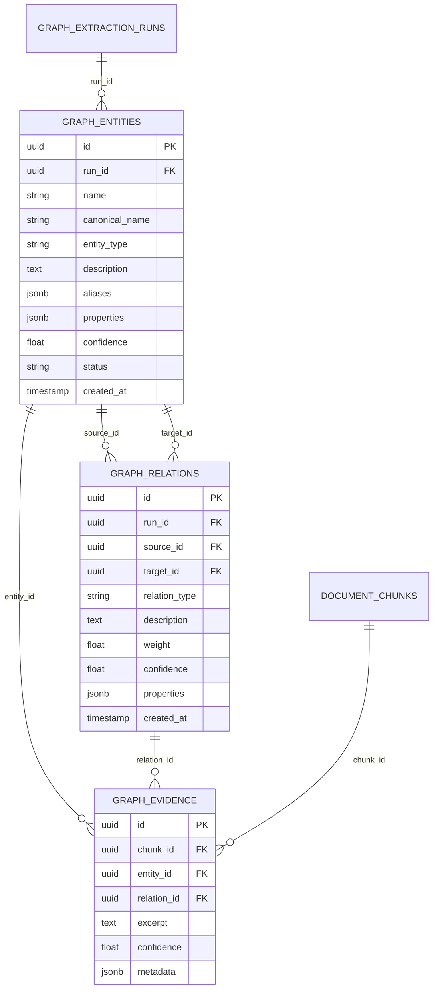
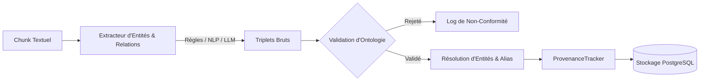
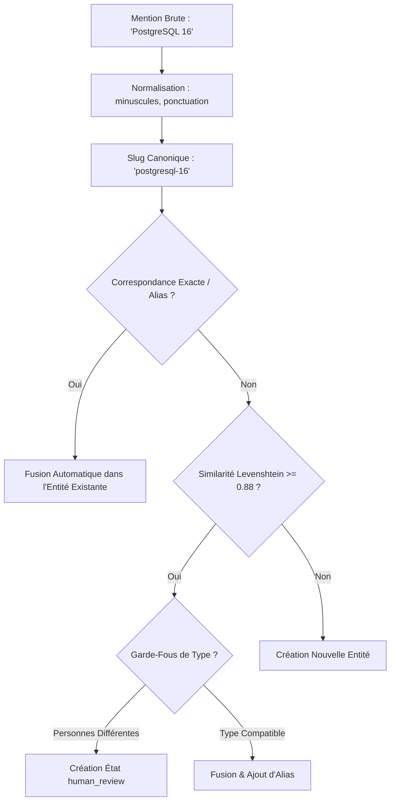

# Tutoriel 11 : Graph RAG & Ingénierie des Graphes de Connaissances

Bienvenue dans le module **Phase 11 — Graph RAG & Ingénierie des Graphes de Connaissances** du laboratoire d'ingénierie RAG (`rag-engineering-lab`).

Dans les phases précédentes, nous avons exploré la recherche vectorielle dense (Phase 05), le RAG naïf (Phase 06), la recherche hybride dense/lexicale avec reclassement (Phase 08), la mémoire conversationnelle (Phase 09) et l'orchestration agentique multi-outils (Phase 10).

Tous ces systèmes s'appuient fondamentalement sur des **segments de texte non structurés (chunks)**. Cependant, la recherche vectorielle pure présente des limites structurelles majeures face à des requêtes relationnelles complexes ("multi-hop"), des questions de synthèse globale ("quelles sont les thématiques transversales du document ?"), ou des distinctions d'entités ambiguës.

Ce tutoriel démontre comment construire, interroger et exploiter un **Graphe de Connaissances (Knowledge Graph)** entièrement intégré dans PostgreSQL 16 avec pgvector, sans dépendance obligatoire envers une base graphique externe lourde, pour offrir un système **Graph RAG** modulaire, performant et vérifiable.

---

## 1. Pourquoi le Graph RAG ? Vecteurs vs. Graphes

```mermaid
flowchart TD
    subgraph VectorRAG["RAG Vectoriel Traditionnel"]
        VQ[Requête Utilisateur] --> VE[Embedding Requête]
        VE --> VIndex[(Index Cosinus pgvector)]
        VIndex --> VChunks[Top-K Chunks Textuels]
        VChunks --> VLLM[LLM Générateur]
    end

    subgraph GraphRAG["Graph RAG Hybride"]
        GQ[Requête Utilisateur] --> GEL[Liaison d'Entités & Mots-clés]
        GEL --> GRec[Traversée Récursive CTE SQL]
        GEL --> GVec[Recherche Vectorielle pgvector]
        GRec --> GTriples[Sous-Graphe & Triplets Liés]
        GVec --> GChunks[Chunks Textuels Complémentaires]
        GTriples --> GFuse[Fusion RRF & Contexte Structuré]
        GChunks --> GFuse
        GFuse --> GLLM[LLM Générateur avec Preuves [S1], [S2]]
    end
```

### Les 3 Faiblesses Structurelles du RAG Vectoriel Pur

1. **L'échec du raisonnement multi-saut (Multi-Hop) :**
   - *Question :* *"Avec quel client l'employeur de Yassir en 2022 a-t-il contractualisé pour le projet de paiement ?"*
   - Dans un corpus documentaire, la date et l'employeur figurent dans la section "Expérience professionnelle", tandis que les clients ou sous-projets peuvent figurer dans une annexe ou un paragraphe distinct.
   - Les vecteurs mesurent une proximité thématique globale ; ils ne peuvent pas suivre un chemin sémantique transitif : `(Yassir) -[WORKED_AT]-> (Entreprise) -[DELIVERED_PROJECT_FOR]-> (Client)`.

2. **L'ambiguïté des entités et des acronymes (Entity Disambiguation) :**
   - Un mot-clé comme "BERT" peut désigner un modèle NLP (`TECHNOLOGY`), un individu prénommé Bert (`PERSON`), ou une division d'entreprise (`ORGANIZATION`).
   - Le graphe de connaissances ancre chaque mention dans une entité typée avec ses alias, résolvant immédiatement la polysémie.

3. **L'incapacité à synthétiser des communautés globales (Sensemaking) :**
   - *"Quels sont les domaines d'expertise majeurs de l'organisation ?"*
   - Un modèle vectoriel extrait 5 chunks au hasard qui mentionnent des technologies spécifiques.
   - Le Graph RAG détecte des **communautés denses** de concepts fortement interconnectés (ex: IA & NLP, DevOps & Cloud, Génie Logiciel) et synthétise chaque groupe thématique.

---

## 2. Modèle de Données : Property Graph dans PostgreSQL 16

Plutôt que d'introduire Neo4j comme dépendance obligatoire avec sa surcharge mémoire et ses contraintes opérationnelles, notre architecture modélise un **graphe de propriétés typé (Property Graph)** natif dans PostgreSQL avec l'abstraction `BaseGraphRepository`.



### Tables du Graphe
- **`graph_entities` :** Nœuds du graphe possédant un `canonical_name` normalisé, un type ontologique (`PERSON`, `ORGANIZATION`, `TECHNOLOGY`, `LOCATION`, `CONCEPT`, `PROJECT`, `EVENT`), des alias et un vecteur d'attributs JSONB.
- **`graph_relations` :** Arêtes orientées reliant `source_id` et `target_id`, typées selon l'ontologie (`WORKS_AT`, `USES_TECH`, `COLLABORATES_WITH`, `PART_OF`, `LOCATED_IN`, `MASTERS`, etc.) avec un poids numérique $w \in [0, 1]$.
- **`graph_evidence` :** Clé de voûte de la vérifiabilité. Relie chaque entité et chaque relation aux identifiants exacts des chunks sources (`chunk_id`), avec l'extrait textuel verbatim qui justifie son extraction.
- **`graph_extraction_runs` :** Métadonnées d'exécution (modèle utilisé, nombre de nœuds/arêtes générés, durée, paramètres).

---

## 3. Pipeline d'Extraction & Validation d'Ontologie

Le pipeline d'extraction transforme le texte brut ou segmenté en triplets structurés $(S, R, T)$ :



### 1. Stratégies d'Extraction Multi-Moteurs
Notre module prend en charge 3 extracteurs interchangeables :
1. **Rule-Based Extractor (`RuleBasedEntityExtractor`, `RuleBasedRelationExtractor`) :** Analyse déterministe ultra-rapide par motifs regex, détection syntaxique et dictionnaires d'entités spécialisés. Zéro coût d'inférence LLM, reproductibilité à 100%.
2. **NLP Pattern Extractor :** Analyse des dépendances et co-occurrences pour identifier des verbes relationnels.
3. **Structured LLM Extractor (`StructuredLLMExtractor`) :** Invocation guidée du LLM (avec schéma JSON strict) pour extraire des relations implicites ou complexes, avec repli automatique sur les règles en cas d'indisponibilité.

### 2. Validation Stricte d'Ontologie (`GraphSchemaValidator`)
Pour éviter l'explosion combinatoire de relations fantaisistes, chaque relation doit respecter les contraintes de domaine et d'image :
- Exemple : La relation `WORKS_AT` exige une source de type `PERSON` et une cible de type `ORGANIZATION`. Un triplet comme `(Python) -[WORKS_AT]-> (Google)` est intercepté et rejeté immédiatement.

---

## 4. Résolution d'Entités & Déduplication

Dans un document ou une collection de documents, la même entité réelle apparaît sous différentes formes lexicales :
- *"Yassir"*, *"Yassir B."*, *"M. Yassir"* $\rightarrow$ Même personne.
- *"Postgres"*, *"PostgreSQL"*, *"PG"* $\rightarrow$ Même technologie.



### Le Danger des Fusions Inconsidérées
> [!WARNING]
> La fusion naïve par similarité de chaîne de caractères sur des entités de type `PERSON` peut fusionner des individus distincts (par exemple deux collaborateurs aux prénoms proches). Notre `EntityResolver` interdit les fusions de personnes sans alias préexistant explicite et positionne le statut en `human_review` pour validation humaine.

---

## 5. Traversée de Graphe Bornée par CTE Récursives SQL

Pour interroger le graphe sans charger l'intégralité du réseau en mémoire applicative, nous exploitons la puissance des **Common Table Expressions (CTE) récursives** de PostgreSQL 16.

```sql
WITH RECURSIVE graph_traverse AS (
    -- Nœud de départ (profondeur 0)
    SELECT
        e.id AS current_entity_id,
        ARRAY[e.id] AS path,
        0 AS depth,
        1.0::float AS path_weight
    FROM graph_entities e
    WHERE e.canonical_name = 'yassir'

    UNION ALL

    -- Expansion récursive vers les voisins (profondeur 1..N)
    SELECT
        r.target_id AS current_entity_id,
        gt.path || r.target_id,
        gt.depth + 1,
        gt.path_weight * r.weight
    FROM graph_traverse gt
    JOIN graph_relations r ON r.source_id = gt.current_entity_id
    WHERE gt.depth < :max_hops
      AND NOT (r.target_id = ANY(gt.path)) -- Détection et rupture de cycle
      AND r.confidence >= :min_confidence
)
SELECT DISTINCT current_entity_id, depth, path_weight
FROM graph_traverse
ORDER BY path_weight DESC, depth ASC;
```

### Avantages de cette approche :
- **Latence ultra-faible :** Exécution en $2 \text{ à } 12 \text{ ms}$ directement sur le moteur PostgreSQL avec les index sur `source_id` et `target_id`.
- **Prévention des boucles infinies :** L'opérateur SQL `NOT (target_id = ANY(path))` élimine formellement les cycles.
- **Bornage strict :** Paramètre `max_hops` limitant la profondeur d'exploration (par défaut 2 sauts).

---

## 6. Les 5 Stratégies de Recherche Graph RAG

| Stratégie | Mécanisme Principal | Cas d'Usage Idéal | Force Majeure |
| :--- | :--- | :--- | :--- |
| **1. Vector Baseline** | Recherche vectorielle cosinus pure sur `document_chunks`. | Questions sémantiques simples, descriptions textuelles diffuses. | Très rapide, insensible à la structure du graphe. |
| **2. Entity Graph** | Liaison d'entités dans la requête + récupération des triplets de degré 1. | Questions directes sur les attributs ou relations d'une entité connue. | Zéro hallucination sur les relations directes. |
| **3. Multi-Hop Traversal** | Expansion récursive à 2 ou 3 sauts le long des relations typées. | Questions complexes en chaîne (*"Qui a utilisé la technologie X chez l'entreprise Y ?"*). | Découvre des preuves dispersées dans des sections éloignées. |
| **4. Hybrid Graph + Vector** | Fusion RRF (Reciprocal Rank Fusion) des chunks textuels et des triplets du graphe. | Requêtes réelles d'utilisateurs combinant contexte descriptif et faits précis. | Meilleure pertinence globale (MRR et Recall maximisés). |
| **5. Community Thematic** | Détection de communautés modulaires (Louvain/Propagation) et synthèse par grappe. | Questions macroscopiques (*"Quels sont les piliers technologiques du candidat ?"*). | Synthèse holistique et structuration thématique du corpus. |

---

## 7. Intégrité des Citations et Traçabilité

Dans notre système, un triplet du graphe n'est jamais présenté comme une vérité abstraite non vérifiable.

Chaque fait extrait possède un lien direct vers son extrait textuel source via `graph_evidence`. Lors de la construction du contexte par `GraphContextBuilder`, chaque élément reçoit une balise de source unique et stable :

```
[S1] ENTITÉ: Yassir (Type: PERSON)
     Preuve: "Yassir - Ingénieur RAG & Architecte IA" (Source: cv_yassir.pdf, Chunk #1)

[S2] RELATION: Yassir -[MASTERS]-> FastAPI (Poids: 0.95)
     Preuve: "Développement d'APIs performantes sous FastAPI et PostgreSQL" (Chunk #3)

[S3] RELATION: Yassir -[WORKED_AT]-> TechCorp (Poids: 0.90)
     Preuve: "Ingénieur logiciel senior chez TechCorp de 2021 à 2023" (Chunk #5)
```

Le modèle de langage génère alors une réponse rigoureusement ancrée :
> *"Yassir est un ingénieur logiciel et architecte IA [S1] qui a travaillé chez TechCorp [S3] et maîtrise le développement avec FastAPI [S2]."*

Toute affirmation dépourvue de balise `[S#]` valide est interceptée par le vérificateur de citations.

---

## 8. L'Interface Graph RAG Studio

Le laboratoire fournit une interface React dédiée à 7 onglets :

1. **Graph Builder :** Sélection du document source, choix de l'extracteur (Règles, NLP, LLM), seuil de confiance et déclenchement de la construction.
2. **Graph Explorer :** Visualisation interactive en réseau vectoriel SVG avec zoom, pan, sélection de nœuds, filtrage par type et panneau latéral d'inspection des triplets et preuves associées.
3. **Entity Resolution :** Table de déduplication, détection d'alias, score de similarité de Levenshtein et boutons d'approbation manuelle pour les entités sous revue.
4. **Graph Query Lab :** Exécution interactive des requêtes en langage naturel avec choix de la stratégie, profondeur de saut et inspection détaillée de la traversée et de la réponse citée.
5. **Communities :** Détection de clusters thématiques, métriques de centralité et de densité, et génération de résumés par communauté.
6. **Strategy Compare :** Comparaison côte-à-côte des 5 stratégies sur la même requête (latence, triplets trouvés, chunks textuels, fidélité).
7. **Learning Center :** Guide théorique interactif, schémas pédagogiques, et glossaire complet d'ingénierie des graphes de connaissances.

---

## 9. Conclusion & Meilleures Pratiques

- **Commencez toujours par un schéma ontologique restreint :** Définir 5 à 8 types d'entités et 8 à 12 types de relations claires évite la dispersion du graphe.
- **Associez toujours Graphe et Vecteurs :** Le Graph RAG ne remplace pas les vecteurs ; il les complète en fournissant la topologie relationnelle et l'explicabilité là où les vecteurs fournissent la nuance sémantique.
- **Conservez la preuve documentaire :** Ne détruisez jamais le lien entre les triplets du graphe et les chunks originaux. C'est l'unique garantie contre les hallucinations et les erreurs d'extraction.
