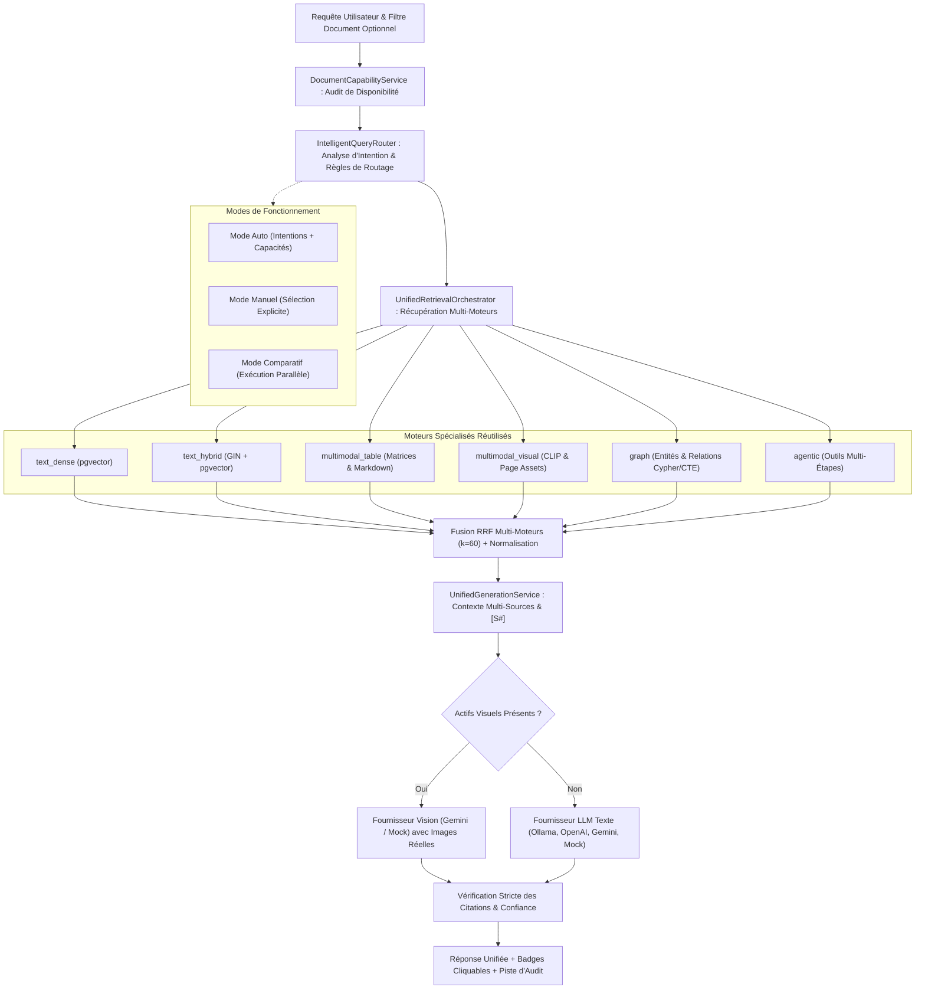

# Tutoriel 12.5 : RAG Unifié & Routage Intelligent de la Récupération

Bienvenue dans le module **Phase 12.5 — RAG Unifié & Routage Intelligent** du laboratoire d'ingénierie RAG (`rag-engineering-lab`).

Au fil des douze premières phases, nous avons construit des moteurs de recherche spécialisés extrêmement puissants :
- **Phase 05 / 06** : Recherche sémantique vectorielle dense sur morceaux de texte linéaires (`text_dense`).
- **Phase 08** : Recherche hybride fusionnant recherche lexicale plein texte (PostgreSQL GIN `tsvector`) et recherche vectorielle avec reranking Cross-Encoder (`text_hybrid`).
- **Phase 10** : RAG Agentique avec sélection d'outils et boucle Plan-Act-Observe (`agentic`).
- **Phase 11** : Graph RAG basé sur des parcours récursifs SQL de graphes de connaissances entités-relations (`graph`).
- **Phase 12** : RAG Multimodal exploitant des matrices de tableaux structurés (`multimodal_table`), des représentations visuelles CLIP ViT-B/32 et des modèles vision-langage (`multimodal_visual`).

Cependant, un problème critique d'ingénierie est apparu : **l'effet silo**.
L'interface de conversation générale (Phase 06) interrogeait uniquement l'index de chunks textuels. Lorsqu'un utilisateur posait une question sur un tableau planétaire extrait dans la Phase 12 (`rag_multimodal_benchmark_solar_system.pdf`), le système ne trouvait aucun chunk textuel pour ce document et retournait un morceau non pertinent issu d'un autre document (`cv_yassir.pdf`), aboutissant à un refus injustifié ou à une hallucination.

Ce tutoriel détaille la conception, l'architecture et le déploiement d'une **couche d'orchestration unifiée et explicable**, capable d'auditer dynamiquement les capacités des documents, de router les requêtes vers les moteurs appropriés, de fusionner des preuves hétérogènes et de produire des réponses visuellement et textuellement ancrées.

---

## 1. Du Silo Spécialisé au RAG Unifié

---

## 2. Le Défi de la Préparation d'Index : `DocumentCapabilityService`

Dans un laboratoire d'ingénierie RAG complet, chaque document subit différents pipelines de traitement :
1. Découpage en morceaux de texte (Phase 03) $\to$ `text_chunks`.
2. Calcul d'embeddings denses (Phase 04) $\to$ `chunk_embeddings`.
3. Extraction de graphe de connaissances (Phase 11) $\to$ `graph_evidence`.
4. Analyse de mise en page et détection de tableaux (Phase 12) $\to$ `document_elements` (type `table`).
5. Rendu de pages et encodage CLIP (Phase 12) $\to$ `document_page_assets` et `multimodal_embeddings`.

Un document peut très bien posséder 166 éléments de mise en page et 4 tableaux structurés, mais **zéro chunk textuel** si le pipeline de chunking texte de la Phase 03 n'a pas été exécuté pour lui.

### Audit des Capacités en Temps Réel
Le `DocumentCapabilityService` interroge la base PostgreSQL pour construire un profil de capacités :
- `text_chunk_count`
- `text_embedding_count`
- `table_element_count`
- `page_asset_count`
- `clip_embedding_count`
- `graph_evidence_count`

Grâce à cet audit :
- Si l'utilisateur restreint sa recherche à un document sans chunks de texte, le routeur **n'invoque pas** `text_dense` ou `text_hybrid`, évitant ainsi de renvoyer par erreur des chunks d'un autre document non ciblé.
- L'interface utilisateur affiche immédiatement des puces d'état (badges verts/gris) indiquant les modalités disponibles pour chaque document sélectionné.

---

## 3. Le Routeur Intelligent : `IntelligentQueryRouter`

Le routeur analyse à la fois la formulation linguistique de la requête et les capacités documentaires.

### 3.1 Détection des Intentions
1. **Intention Tabulaire (`tabular`) :** Détecte les termes numériques, matriciels et statistiques (*"table"*, *"tableau"*, *"gravity"*, *"gravité"*, *"valeur"*, *"pourcentage"*, *"colonnes"*).
2. **Intention Visuelle (`visual`) :** Détecte les requêtes orientées figures, schémas, photos et aspects spatiaux (*"image"*, *"figure"*, *"schéma"*, *"diagramme"*, *"photo"*, *"layout"*).
3. **Intention Relationnelle / Graphe (`relational`) :** Détecte les questions de liens, d'appartenance, de dépendance ou de hiérarchie (*"qui est lié à"*, *"relation"*, *"dépendance"*, *"hiérarchie"*, *"connecté"*).
4. **Intention Agentique Multi-Étapes (`agentic`) :** Détecte les requêtes complexes nécessitant comparaison, croisement ou décomposition (*"compare"*, *"étapes"*, *"synthétise tous les documents"*, *"analyse complète"*).
5. **Intention Textuelle Standard :** Si aucune intention spécifique n'est prédominante, les routes `text_hybrid` et `text_dense` sont sélectionnées par défaut.

### 3.2 Synthèse Intention $\times$ Capacités
Le routeur confronte les intentions détectées avec le rapport de capacités. Par exemple, si une intention tabulaire est détectée et que le document cible possède des tableaux extraits, la route `multimodal_table` est activée en priorité absolue. Si le document ne possède aucune donnée tabulaire, un avertissement transparent est émis et le système bascule gracieusement sur la recherche textuelle ou émet un refus explicite.

---

## 4. Normalisation des Scores et Fusion RRF Multi-Moteurs

Chaque moteur de recherche produit des scores aux échelles et sémantiques incompatibles :
- **Recherche Dense (Cosine) :** $\text{score} \in [-1, 1]$ (distance cosinus inversée).
- **Recherche Lexicale (PostgreSQL `ts_rank_cd`) :** $\text{score} \in [0, +\infty[$ (fréquence et densité de termes).
- **Recherche CLIP Visuelle :** $\text{score} \in [0, 1]$ (similarité cosinus normalisée).
- **Parcours de Graphe :** Nombre de sauts récursifs ou degré de centralité.

Pour fusionner équitablement ces preuves sans biais d'échelle, le `UnifiedRetrievalOrchestrator` applique la **Reciprocal Rank Fusion (RRF)** pondérée :

$$\text{RRF Score}(d) = \sum_{m \in \text{Moteurs}} w_m \cdot \frac{1}{k + \text{rank}_m(d)}$$

Où :
- $k$ est la constante de lissage (standardisé à $k = 60$).
- $\text{rank}_m(d)$ est le rang (1-indexé) du document ou fragment $d$ dans les résultats du moteur $m$.
- $w_m$ est la pondération attribuée au moteur selon la confiance du routage.

### Schéma Unifié des Preuves (`UnifiedEvidenceItem`)
Chaque fragment récupéré est converti dans un schéma standardisé contenant :
- `item_id` et identifiant canonique (`[S1]`, `[S2]`).
- `modality` (`text`, `table`, `image`, `graph`).
- `content` textuel ou Markdown pour le prompt de l'injection.
- `structured_data` (colonnes, lignes, en-têtes de tableau, ou triplets entité-relation-entité).
- `asset_url` (URL de l'image de page ou du schéma graphique).
- `origin_engine` et `score_breakdown` pour une traçabilité totale.

---

## 5. Génération Unifiée et Ancrage Visuel

Une fois les preuves collectées, dédupliquées et ordonnées, le `UnifiedGenerationService` formate le contexte :
1. **Tableaux :** Rendus sous forme de tables Markdown conformes avec indication de la page et du titre.
2. **Images & Schémas :** Référencés avec leur légende, leur numéro de page et leur URL sécurisée.
3. **Triplets de Graphe :** Formatés sous la forme `(Entité Source) -[Relation]-> (Entité Cible)`.
4. **Extraits Textuels :** Encadrés avec métadonnées de section et de document.

### Routage Vision Dynamique
Si la liste des preuves unifiées contient un actif visuel (page contenant un tableau critique ou une figure) et qu'un fournisseur de vision est configuré (`gemini` avec `gemini-3.8-flash` ou `mock`), le système :
1. Valide l'existence locale du fichier image dans le répertoire de stockage sécurisé.
2. Lit les octets de l'image et prépare les parties `inline_data` Base64.
3. Transmet à la fois le prompt textuel et les images réelles au modèle de vision.
4. Extrait la réponse en s'assurant que les citations bracketées (`[S1]`, `[S2]`) pointent strictement vers les preuves fournies.

---

## 6. L'Interface React du RAG Chat Unifié

L'interface de RAG Chat intègre désormais l'ensemble de ces innovations :
1. **Sélecteur de Document Cible & Puces de Disponibilité :** L'utilisateur visualise immédiatement si le document sélectionné dispose de chunks texte, de tableaux, d'images ou d'un graphe.
2. **Sélecteur de Mode de Routage :**
   - *Auto (Recommandé) :* Analyse automatique de la question.
   - *Manuel :* Cochage manuel des moteurs à interroger (`text_dense`, `multimodal_table`, `graph`, etc.).
   - *Comparatif :* Visualisation côte-à-côte des réponses et des latences entre les différentes stratégies.
3. **Piste d'Audit du Routeur (Router Decision Trail) :** Présente les routes sélectionnées, les intentions détectées, la justification de l'arbitrage et les alertes d'index manquant.
4. **Cartes de Preuves par Modalité :**
   - Les tableaux sont rendus sous forme de grilles interactives.
   - Les figures et pages affichent une miniature prévisualisable.
   - Les triplets affichent les relations du graphe.
5. **Citations Interactives :** Cliquer sur un jeton `[S1]` dans la bulle de message fait défiler l'écran directement vers la carte de preuve correspondante et la met en surbrillance dorée.

---

## 7. Résumé des Bonnes Pratiques d'Ingénierie

1. **Ne Jamais Supposer la Présence d'un Index :** Toujours vérifier les capacités réelles du document avant de déclencher des requêtes coûteuses ou susceptibles de fuiter sur d'autres documents.
2. **Séparer la Normalisation des Scores du Classement :** Les scores bruts hétérogènes mènent au désastre lorsqu'ils sont sommés directement. L'utilisation du RRF basé sur le rang résout l'incompatibilité des métriques.
3. **Assurer la Traçabilité de Bout en Bout :** Chaque jeton `[S#]` doit pouvoir être relié à sa source physique (fichier, page, coordonnées de layout, ligne de tableau).
4. **Dégrader avec Transparence :** Si une modalité demandée est indisponible, l'expliquer explicitement à l'utilisateur plutôt que d'inventer une réponse non étayée.
