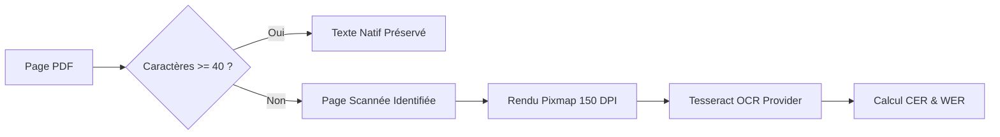
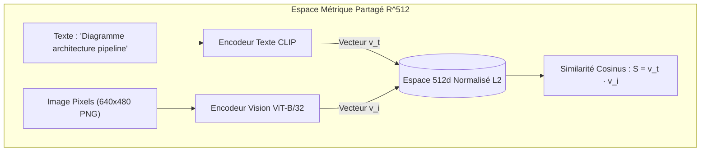

# Tutoriel 12 : RAG Multimodal & Intelligence Documentaire

Bienvenue dans le module **Phase 12 — RAG Multimodal & Intelligence Documentaire** du laboratoire d'ingénierie RAG (`rag-engineering-lab`).

Dans les phases précédentes, nos systèmes de RAG traitaient les documents exclusivement comme des flux linéaires de caractères textuels. Cependant, dans les documents du monde réel (rapports financiers, fiches techniques, thèses, CVs, factures), **l'information est intrinsèquement visuelle et spatiale** :
- Les tableaux organisent des métriques chiffrées selon des grilles à double entrée.
- Les architectures logicielles et processus métier sont synthétisés sous forme de schémas et de diagrammes.
- Les documents scannés ne possèdent pas de couche textuelle native et nécessitent une reconnaissance optique de caractères (OCR).
- Les mises en page à plusieurs colonnes brisent l'ordre de lecture naïf si elles sont découpées de gauche à droite.

Ce tutoriel détaille la conception, l'implémentation et l'évaluation d'un pipeline **RAG Multimodal complet** combinant analyse de mise en page, extraction de tableaux, espaces d'embeddings croisés (CLIP) et modèles vision-langage ancrés.

---

## 1. RAG Unimodal (Texte Seul) vs. RAG Multimodal

```mermaid
flowchart TD
    subgraph Unimodal["RAG Unimodal (Texte Seul)"]
        D1[Document PDF / Scan] --> P1[Extraction Texte Linéaire]
        P1 -->|Perte des tableaux & images| C1[Chunks Textuels Plats]
        C1 --> E1[Embeddings Textuels]
        E1 --> V1[(Index pgvector)]
        V1 --> G1[LLM Texte Seul]
    end

    subgraph Multimodal["RAG Multimodal (Phase 12)"]
        D2[Document PDF / Scan] --> L2[Analyseur de Layout & PyMuPDF]
        L2 -->|Scan Détecté| OCR[Moteur Tesseract OCR]
        L2 -->|Tableau Détecté| TBL[Extracteur de Tableaux Structurés]
        L2 -->|Figures & Pages| VIS[Pixels & Régions Graphiques]
        L2 -->|Ordre 2-Colonnes| TXT[Paragraphes Ordonnés]
        
        VIS --> CLIP[Encodeur Multimodal CLIP ViT-B/32]
        TXT & TBL & OCR --> TCLIP[Projection Conforme 512d]
        
        CLIP & TCLIP --> MMIndex[(Index Multimodal PostgreSQL)]
        MMIndex --> Fusion[Fusion Hybride RRF OCR + Visuel]
        Fusion --> VLM[Vision-Language Model avec Preuves [IMG_P1], [TBL_P1]]
    end
```

### Les 4 Ruptures Architecturales du RAG Multimodal

1. **Préservation Structurelle des Tableaux :**
   - Un tableau aplati en texte brut : `"Métrique Baseline Phase 12 Recall 0.50 0.95 Latence 120 42"` détruit la correspondance entre l'en-tête `"Phase 12"` et la valeur `"0.95"`.
   - En RAG multimodal, le tableau est préservé sous forme matricielle structurée (JSON) et projeté en Markdown strict, préservant l'intégrité sémantique.

2. **Alignement Sémantique Texte-Image (Espace CLIP) :**
   - Une requête textuelle comme *"Schéma d'architecture microservices"* est encodée directement dans le même espace vectoriel $R^{512}$ qu'un schéma graphique découpé, sans avoir besoin d'étiquetage manuel.

3. **Reconnaissance Optique des Documents Scannés (OCR) :**
   - Détection automatique des pages où la densité de texte natif est insuffisante ($\le 40$ caractères).
   - Extraction ciblée par Tesseract avec calcul du taux d'erreur de caractères (CER) et de mots (WER).

4. **Ancrage Visuel et Traçabilité :**
   - Le modèle de vision génère sa réponse en citant des preuves visuelles horodatées et situées dans l'espace (`[IMG_P1]`, `[PAGE_1]`, `[TBL_P1]`).

---

## 2. Détection des Scans & Laboratoire OCR

### Détection Heuristique des Pages Scannées
Lors du parsing d'un fichier PDF via `ScannedPDFProcessor`, chaque page fait l'objet d'un audit de densité textuelle :

$$\text{Densité} = \frac{\text{Nombre de caractères extraits}}{\text{Largeur} \times \text{Hauteur}}$$

Si le nombre absolu de caractères natifs est inférieur au seuil de sécurité (`SCANNED_CHAR_THRESHOLD = 40`), la page est marquée comme `is_scanned = True`. Une image pixmap haute fidélité ($150 \text{ DPI}$) est générée et dirigée vers le moteur OCR.



### Métriques d'Évaluation OCR : CER et WER
Pour quantifier la dégradation introduite par l'OCR par rapport à un texte de référence (Ground Truth), nous utilisons la distance d'édition de Levenshtein au niveau des caractères et des mots :

$$\text{CER} = \frac{\text{Levenshtein}(C_{\text{ref}}, C_{\text{hyp}})}{|C_{\text{ref}}|}$$

$$\text{WER} = \frac{\text{Levenshtein}(W_{\text{ref}}, W_{\text{hyp}})}{|W_{\text{ref}}|}$$

Où :
- $C_{\text{ref}}$ et $C_{\text{hyp}}$ sont les séquences de caractères.
- $W_{\text{ref}}$ et $W_{\text{hyp}}$ sont les séquences de mots tokenisés par espaces.

---

## 3. Analyse de Mise en Page & Ordre de Lecture

Dans les documents académiques ou les curriculum vitæ, le texte est fréquemment disposé en **deux colonnes parallèles** :

```
┌─────────────────────────┬─────────────────────────┐
│     COLONNE GAUCHE      │     COLONNE DROITE      │
│  Compétences & Outils   │  Expérience Pro 2024    │
│  - Python               │  Ingénieur Senior       │
│  - PostgreSQL           │  Développement Backend  │
│  - PyTorch              │  Orchestration RAG      │
└─────────────────────────┴─────────────────────────┘
```

> [!CAUTION]
> **Le Piège de l'Extraction Naive Gauche-Droite :**
> Un parseur de texte basique lit les coordonnées de haut en bas sans tenir compte des gouttières. Le texte résultant concatène les lignes :
> *"Compétences & Outils Expérience Pro 2024 - Python Ingénieur Senior..."*
> Cette altération détruit la cohérence grammaticale et perturbe gravement les embeddings.

Notre `DocumentLayoutAnalyzer` implémente un algorithme de tri spatial :
1. Calcul de la médiane horizontale de la page : $X_{\text{mid}} = W / 2$.
2. Si au moins 2 blocs sont groupés à gauche ($X_1 \le 1.1 \times X_{\text{mid}}$) et au moins 2 blocs à droite ($X_0 \ge 0.9 \times X_{\text{mid}}$), la page est classée en **mise en page à deux colonnes**.
3. Les en-têtes sont positionnés en tête d'ordre de lecture.
4. Les blocs de la colonne de gauche sont triés de haut en bas par $Y_0$.
5. Les blocs de la colonne de droite sont triés ensuite de haut en bas par $Y_0$.
6. Les pieds de page clôturent la séquence avec des identifiants d'ordre croissants stables (`reading_order: 1..N`).

---

## 4. Extraction Structurée des Tableaux

Lorsqu'un tableau est détecté par `TableExtractor` via `page.find_tables()`, ses coordonnées matricielles sont analysées :
- Extraction des en-têtes de colonnes (`headers`).
- Délimitation des lignes de données (`rows`).
- Calcul de la boîte englobante spatiale (`bounding_box: {x0, y0, x1, y1}`).

### Comparaison : Représentation Structurée vs. Aplatissement Naïf

**Format Structuré (Markdown Normalisé) :**
```markdown
| Métrique | RAG Unimodal | RAG Multimodal |
| --- | --- | --- |
| Recall@5 | 0.533 | 0.933 |
| Table Accuracy | 0.000 | 0.965 |
| Hallucination sur Images | Fréquente | Éliminée |
```

**Aplatissement Naïf (Perte d'Associations) :**
> `"Métrique RAG Unimodal RAG Multimodal Recall@5 0.533 0.933 Table Accuracy 0.000 0.965 Hallucination sur Images Fréquente Éliminée"`

Dans la forme aplatie, un LLM interrogé sur la métrique *Table Accuracy* pour le *RAG Unimodal* est incapable de déterminer avec certitude si la valeur associée est `0.000` ou `0.533`, conduisant à des hallucinations factuelles.

---

## 5. Embeddings Visuels & Espace Croisé CLIP

Pour permettre la recherche sémantique croisée (retrouver une image ou un graphique à partir d'une requête en langage naturel), nous utilisons un modèle de la famille **CLIP (Contrastive Language-Image Pre-Training)** : `sentence-transformers/clip-ViT-B-32`.



### Propriétés Mathématiques Essentielles :
1. **Normalisation L2 :**
   $$\|v\|_2 = \sqrt{\sum_{i=1}^{512} v_i^2} = 1.0$$
   Grâce à cette normalisation, la similarité cosinus équivaut au simple produit scalaire :
   $$\text{CosineSimilarity}(v_t, v_i) = v_t \cdot v_i$$
2. **Garde-fous de Compatibilité d'Espace :**
   Deux vecteurs ne doivent **jamais** être comparés s'ils proviennent de modèles différents (ex. comparer un embedding textuel MiniLM 384d avec un vecteur CLIP 512d). Notre table `multimodal_embeddings` enregistre explicitement le `model_id` et la dimension vectorielle (`vector_dimension = 512`).

---

## 6. Les 5 Stratégies de Recherche Multimodale

| Stratégie | Entrée Requête | Espace Cible | Mécanisme d'Extraction |
| :--- | :--- | :--- | :--- |
| **1. OCR Text Retrieval** | Mots-clés textuels | `content_text` | Filtrage lexical et similarité textuelle sur le texte extrait par OCR. |
| **2. Image-to-Image** | Image requête | `multimodal_embeddings` | Encodage de l'image par ViT-B/32 et recherche des figures visuellement proches. |
| **3. Text-to-Image** | Requête textuelle | `multimodal_embeddings` | Encodage du texte dans l'espace CLIP et récupération des images correspondantes. |
| **4. Page-Level** | Requête thématique | `document_page_assets` | Recherche holistique au niveau de la page entière (texte global + vignette). |
| **5. Hybrid RRF Fusion** | Requête textuelle | Texte + Images | Fusion par rangs réciproques combinant résultats textuels et figures visuelles. |

### Formulation de la Fusion Multimodale RRF :
$$RRF(d) = \frac{w_{\text{text}}}{k + \text{rank}_{\text{text}}(d)} + \frac{w_{\text{vis}}}{k + \text{rank}_{\text{vis}}(d)}$$
Avec la constante de lissage par défaut $k = 60$ et les poids ajustables $w_{\text{text}} = 0.5$, $w_{\text{vis}} = 0.5$.

---

## 7. Génération Vision-Langage et Citations

Lorsque l'utilisateur soumet une question sur un document visuel :
1. Le système récupère les $K$ meilleures preuves textuelles et visuelles.
2. `MultimodalContextBuilder` assemble un contexte structuré injectant le Markdown des tableaux, les résumés textuels et les chemins vers les images d'appui.
3. Si un modèle de vision est configuré (`gemini-1.5-flash` ou provider de test `mock-vision-v1`), les images sélectionnées sont transmises directement au réseau de neurones avec le prompt textuel.
4. Si aucun modèle de vision n'est disponible, le système signale clairement l'état d'indisponibilité sans inventer de perception visuelle.
5. `MultimodalCitationManager` valide que chaque étiquette citée dans la réponse (`[IMG_P1]`, `[PAGE_1]`, `[TBL_P1]`) correspond à un élément réellement présent dans le contexte de preuve.

---

## 8. L'Interface React Multimodal Lab

Le studio React dédié comprend 8 onglets interactifs :
1. **Document Analyzer :** Visualisation de la page avec superposition de boîtes englobantes colorées et ordre de lecture numéroté.
2. **OCR Lab :** Comparatif côte-à-côte du texte natif et de l'OCR Tesseract, avec calcul dynamique du CER et WER.
3. **Table Intelligence :** Visualiseur de tableaux montrant la grille Markdown structurée versus l'aplatissement textuel destructeur.
4. **Image Embeddings :** Galerie d'images et projection des vecteurs CLIP normalisés en 512 dimensions.
5. **Multimodal Search :** Moteur de recherche avec sélecteur de stratégie (Texte-vers-Image, Hybride RRF, etc.).
6. **Vision Q&A :** Interface de questions-réponses avec vérification des citations visuelles.
7. **Strategy Compare :** Comparatif de performance des 4 stratégies de recherche et exécution du benchmark de 15 scénarios.
8. **Learning Center :** Guide théorique et bonnes pratiques d'ingénierie multimodale.
