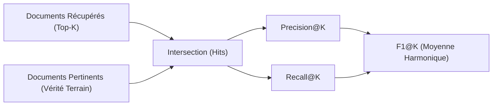
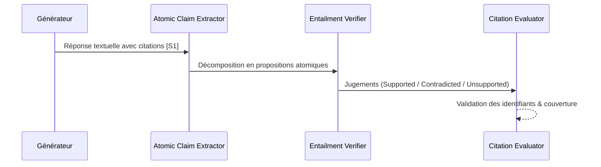

# Tutoriel 13 : Évaluation RAG, Observabilité & Ingénierie de la Qualité

Bienvenue dans le module **Phase 13 — RAG Evaluation, Observability & Quality Engineering** du laboratoire d'ingénierie RAG (`rag-engineering-lab`).

Après avoir construit les fondations d'ingestion (Phases 01–03), les représentations vectorielles (Phase 04), la recherche hybride et les index HNSW (Phases 05–08), la mémoire conversationnelle (Phase 09), les agents autonomes (Phase 10), les graphes de connaissances (Phase 11), le multimodal (Phase 12) et le routage unifié intelligent (Phase 12.5), nous abordons le pilier central de tout système RAG en production : **la mesure scientifique, l'observabilité fine et la garantie de qualité**.

Ce tutoriel détaille la théorie mathématique, l'architecture logicielle et les pratiques d'ingénierie permettant d'évaluer de bout en bout un pipeline RAG hétérogène.

---

## 1. La Problématique : Évaluer au-delà des Impressions Subjectives

Dans un pipeline RAG moderne, une réponse erronée peut provenir de multiples défaillances indépendantes :
1. **Déficit de Récupération (Retrieval Failure)** : Le document pertinent n'a pas été capturé dans le Top-K.
2. **Mauvais Ordonnancement (Ranking Failure)** : Le passage pertinent est présent mais relégué à un rang trop bas pour la fenêtre d'attention.
3. **Erreur d'Aiguillage (Routing Failure)** : Une requête sur un tableau financier a été envoyée vers un index textuel non structuré.
4. **Hallucination Non Ancrée (Faithfulness Failure)** : Le modèle de langage a formulé des affirmations factuelles absentes des passages fournis.
5. **Citations Invalides ou Fallacieuses (Citation Failure)** : Le modèle cite un passage `[S1]` qui ne corrobore pas l'affirmation formulée.
6. **Surexploitation Coûteuse (Resource Waste)** : Déclencher un modèle de vision multimodal ou une boucle agentique multi-étapes sur une question factuelle directe.

L'objectif de la Phase 13 est d'éliminer le flou subjectif grâce à un ensemble unifié de métriques mathématiques déterministes, un traçage structurel en cascade (waterfall) et une comptabilité stricte des coûts par jeton.

---

## 2. Métriques d'Information Retrieval (IR)



### 2.1 Précision@K et Rappel@K
Pour un ensemble ordonné de documents récupérés $\mathcal{R}_K = [d_1, \dots, d_K]$ et un ensemble de documents pertinents de référence $\mathcal{G}$ :

$$\text{Precision}@K = \frac{|\mathcal{R}_K \cap \mathcal{G}|}{K}$$

$$\text{Recall}@K = \frac{|\mathcal{R}_K \cap \mathcal{G}|}{|\mathcal{G}|}$$

### 2.2 F1@K (Moyenne Harmonique)
Le score F1 à rang $K$ équilibre la pureté des résultats (précision) et la complétude de la preuve documentaire (rappel) :

$$\text{F1}@K = 2 \cdot \frac{\text{Precision}@K \cdot \text{Recall}@K}{\text{Precision}@K + \text{Recall}@K}$$

Si $\text{Precision}@K + \text{Recall}@K = 0$, alors $\text{F1}@K = 0$.

### 2.3 Rang Réciproque Moyen (MRR)
Le MRR mesure la vitesse à laquelle le premier document pertinent apparaît dans la liste :

$$\text{RR}(q) = \frac{1}{\min \{ i \mid d_i \in \mathcal{G} \}}, \quad \text{MRR} = \frac{1}{|Q|} \sum_{q \in Q} \text{RR}(q)$$

### 2.4 Précision Moyenne (MAP)
Pour évaluer la qualité de l'ordonnancement de l'ensemble des éléments pertinents :

$$\text{AP}@K = \frac{\sum_{i=1}^K \text{Precision}@i \cdot \mathbb{I}(d_i \in \mathcal{G})}{\min(K, |\mathcal{G}|)}, \quad \text{MAP} = \frac{1}{|Q|} \sum_{q \in Q} \text{AP}(q)$$

### 2.5 nDCG@K avec Gains Gradués
Lorsque la pertinence est graduée ($r(d) \in \{0, 1, 2\}$ pour non pertinent, partiellement pertinent, directement pertinent) :

$$\text{DCG}@K = \sum_{i=1}^K \frac{2^{r(d_i)} - 1}{\log_2(i + 1)}$$

$$\text{nDCG}@K = \frac{\text{DCG}@K}{\text{IDCG}@K}$$

où $\text{IDCG}@K$ est le DCG idéal obtenu en triant parfaitement les passages pertinents par ordre décroissant de gain.

---

## 3. Évaluation Déterministe de la Génération

Contrairement aux approches reposant exclusivement sur des juges LLM opaques, la Phase 13 implémente des métriques de génération strictement déterministes.

### 3.1 Exact Match (EM)
Normalise les chaînes (minuscules, suppression de la ponctuation, contraction des espaces blancs) et évalue l'égalité stricte :
$$\text{EM}(y, \hat{y}) = \begin{cases} 1 & \text{si } \text{norm}(y) = \text{norm}(\hat{y}) \\ 0 & \text{sinon} \end{cases}$$

### 3.2 Token F1 (Unigramme)
Mesure le chevauchement au niveau des mots entre la réponse générée et la référence :
$$P_{\text{token}} = \frac{|\text{Tokens}(y) \cap \text{Tokens}(\hat{y})|}{|\text{Tokens}(\hat{y})|}, \quad R_{\text{token}} = \frac{|\text{Tokens}(y) \cap \text{Tokens}(\hat{y})|}{|\text{Tokens}(y)|}$$
$$F_{1\text{-token}} = 2 \cdot \frac{P_{\text{token}} \cdot R_{\text{token}}}{P_{\text{token}} + R_{\text{token}}}$$

### 3.3 Justesse Numérique et Tolérance Physique
Pour les requêtes quantitatives (tableaux planétaires, métriques financières), la fonction `numerical_correctness` extrait les valeurs numériques (y compris notations scientifiques et nombres négatifs) et vérifie deux conditions :
1. **Écart relatif ou absolu** : $|v_{\text{extrait}} - v_{\text{attendu}}| \le \text{tolérance}$
2. **Concordance d'unité** : présence de l'unité physique normalisée (ex. `m/s²`, `kg/m³`, `AU`, `bar`).

---

## 4. Fidélité Factuelle (Faithfulness) & Analyse des Citations



1. **Extraction de Propositions Atomiques** : Découpage de la réponse générée en assertions unitaires indépendantes (ex. : *"Jupiter est une géante gazeuse"*, *"Sa gravité est de 23.1 m/s²"*).
2. **Vérification d'Implication (Entailment)** : Chaque proposition est confrontée aux passages documentaires fournis.
3. **Métrique de Fidélité** :
$$\text{Faithfulness} = \frac{|\text{Propositions Supportées}|}{|\text{Total Propositions Factuelles}|}$$
4. **Audit des Citations** :
   - $\text{Citation ID Validity}$ : pourcentage de balises citées qui correspondent à des sources réellement injectées dans le prompt.
   - $\text{Citation Support Precision}$ : pourcentage de propositions citées qui sont effectivement soutenues par le passage référencé.
   - $\text{Citation Coverage}$ : proportion des faits énoncés qui disposent d'au moins une citation valide.

---

## 5. Évaluation de la Qualité du Routage (Phase 12.5)

L'introduction du routeur intelligent nécessite des métriques spécifiques :
- **Exactitude de Routage (Route Accuracy)** : Concordance entre le moteur sélectionné (`multimodal_table`, `text_dense`, etc.) et la modalité optimale attendue.
- **Taux de Vision Inutile (Unnecessary Vision Rate)** : Proportion de requêtes чисто textuelles ou tabulaires ayant déclenché un appel d'inférence visuelle coûteux en jetons et en latence.
- **Taux d'Agent Inutile (Unnecessary Agentic Rate)** : Déclenchement d'une boucle multi-étapes pour une question directe à saut unique.
- **Isolation Documentaire (Document Isolation Score)** : Vérification de l'absence totale de fuite de morceaux provenant d'autres documents lorsque la requête est restreinte à un identifiant précis.

---

## 6. Traçabilité Structurée (Observability Waterfall)

La table relationnelle `evaluation_traces` capture pour chaque requête un enregistrement complet découpé par étapes :

```
[Requête]
├── query_analysis      ( 2.1 ms)
├── routing             ( 4.5 ms)  [selected: multimodal_table, mode: auto]
├── retrieval           (12.3 ms)  [evidence_count: 4, table_origin: page_1]
├── context_assembly    ( 1.8 ms)
├── generation          (340.0 ms) [model: gemini-3.8-flash, vision: false]
└── citation_validation ( 3.2 ms)  [citations: 1 valid, 0 invalid]
Total Latency: 363.9 ms
```

### Règle Impérative de Caviardage (Redaction Policy)
Aucun secret (en-tête `x-goog-api-key`, jeton `Bearer`, mot de passe) ni charge utile binaire volumineuse (données d'images Base64 `data:image/...`) ne doit persister dans les traces d'observabilité. Le module `RedactionPolicy` remplace automatiquement ces champs par `[REDACTED_SECRET]` et `[REDACTED_BASE64_IMAGE]`.

---

## 7. Comptabilité des Coûts et Registre des Prix

Le module `ModelPricingRegistry` versionne les tarifs officiels par tranche de 1 000 000 de jetons :
- **Google Gemini 3.8 Flash** : \$0.10 entrée / \$0.40 sortie.
- **OpenAI GPT-4o-mini** : \$0.15 entrée / \$0.60 sortie.
- **Ollama Local (Qwen 2.5:3b)** : \$0.00 (calcul local hébergé).
- **Mock Instruct v1** : \$0.00 (tests automatisés déterministes).

Toute exécution sur un modèle non répertorié indique explicitement `unknown` plutôt que d'afficher un coût factice à 0 dollar.

---

## 8. Utilisation dans le Studio React (Phase 13)

Le studio d'évaluation React s'enrichit de nouveaux onglets :
1. **Overview & KPIs** : Tableau de bord exécutif avec F1@5, Exact Match, Token F1, précision de routage et badges visuels distincts (`[Mock]`, `[Measured]`, `[Estimated]`).
2. **Routing Quality** : Matrice détaillée des décisions de routage par question (détection des gaspillages de vision, isolation documentaire).
3. **Traces & Latency** : Graphique horizontal en cascade (waterfall SVG) et percentiles de latence p50/p95/p99.
4. **Results & Question Inspector** : Inspection approfondie des réponses générées avec exact match, F1 unigramme, conformité numérique et citations.
5. **Export Multi-Formats** : Exportation instantanée des runs au format JSON ou CSV, et des jeux de données d'évaluation en JSONL.

---

## 9. Conclusion

La Phase 13 transforme le `rag-engineering-lab` en une plateforme d'ingénierie rigoureuse. Chaque amélioration d'algorithme (du chunking à la recherche hybride jusqu'au multimodal) peut désormais être validée scientifiquement sur des données réelles avec traçabilité complète, garantie d'isolation et maîtrise budgétaire.
